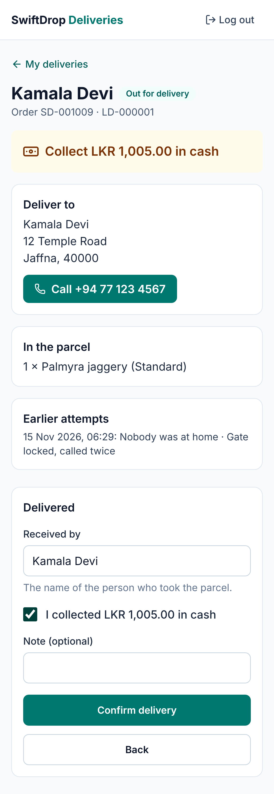
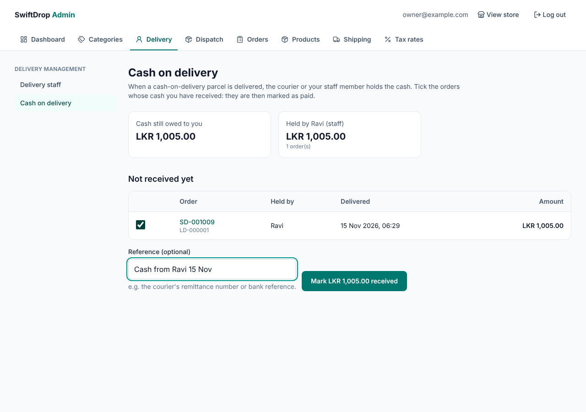

# Phase 10: Delivery management

**Status:** awaiting owner review · **Date:** 2026-11-15 · **Decision D-7:** couriers plus own staff locally. COD is paid when the cash reaches the owner. Proof of delivery is the receiver's name.

## A. What was built
**Flyway V15** (no earlier migration changed):
- own delivery as a courier, off until you set it up;
- service areas by postal code;
- `LD-` references;
- shipment assignment;
- failure reasons and the receiver's name on tracking steps;
- the `cod_collections` table.

**Backend:**
- **Delivery staff role:** `/api/delivery/jobs` (list, details, start / delivered / failed). Each person sees only their own unfinished parcels.
- **Admin:** staff accounts (create, disable, new password), assigning parcels, the cash-on-delivery overview, and "mark received", which makes the orders paid.
- **COD by courier:** a delivered DEX COD order is recorded as cash held by DEX.
- **Order status:** "out for delivery" makes the order *Shipped*; delivered makes it *Delivered*.

**Frontend:**
- Phone-first staff pages (`/delivery`); staff go there after logging in.
- Admin **Delivery** section: staff and cash on delivery.
- Shipment page: *Delivered by*, cash to collect, failure reason and receiver.
- Couriers: postal codes per service.
- Customers see "Delivery attempt failed: …" and "received by …".

## B. Lessons
1. **A "courier" can be your own staff:** reusing shipments and tracking kept order status, reports and expenses working with no new code.
2. **Least privilege:** the staff role reaches only its own unfinished parcels, and the server checks again on every request. Hiding buttons is not enough.
3. **Money changes hands in steps:** "delivered" and "paid" are separate facts. Recording who holds the cash shows what each courier and staff member still owes you.

## C. Verification
**Backend: 156 tests.** New ones:
- 4 delivery integration tests:
  - postal-code areas;
  - the full staff flow, including the failed attempt, cash, the address hidden afterwards, another staff member getting 404, and a disabled session getting 403;
  - courier COD settled from the order page;
  - assignment and account rules.
- The endpoint sweep has a new rule: `/api/delivery/**` is for staff only.

**Frontend: 156 tests**, 10 new. Lint, format, types and build are clean.

**Browser (real PostgreSQL, V15 applied to an existing V14 database):**
- owner set postal codes and added Ravi through the UI;
- checkout offered own delivery only with postal code 40000;
- reference LD-000001; Ravi assigned;
- on an iPhone 13 screen (no sideways scrolling), Ravi recorded a failed attempt, then a delivery with the cash;
- the customer saw both steps, without the note or the staff email;
- the order stayed unpaid until the owner marked the cash received;
- the disabled session was refused.
- The only console errors were the deliberate 403/404 checks.

## D. Owner actions
1. Add the own-delivery rate card and your postal codes, then turn it on.
2. Add your delivery staff.
3. Each week, compare *Cash on delivery* with what DEX and your staff hand you.

## E. Exercises
1. Deliver a test order as a staff member, with one failed attempt first. What does the customer see?
2. Why can't you disable a staff member who still has parcels?
3. Why is a COD order not marked paid when the parcel is delivered?
