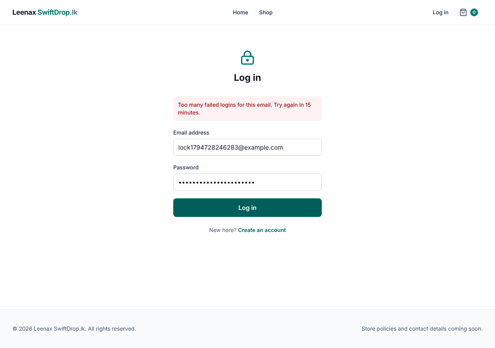

# Phase 11 — Quality, security and performance

**Status:** awaiting owner review · **Date:** 2026-11-15 · Details: [SECURITY.md](../SECURITY.md)

## A. What was built
- **Request limits** for each visitor's address:
  - stricter limits for login, sign-up, prices, checkout and PayHere notifications;
  - over the limit, the answer is 429 with a "please wait" message.
- **Account lockout:** 5 wrong passwords for one email lock it for 15 minutes. This works the same for emails without an account.
- **Change password** for the owner, staff and customers.
- **Security headers** on every API answer.
- **Photo cleaning:**
  - GPS and other metadata are removed;
  - phone photos are turned upright;
  - photos are shrunk to 2000 px;
  - "decompression bombs" are refused.
- **Performance:**
  - a query-count test, which found and fixed an N+1 problem on the dispatch page;
  - indexes (V16);
  - gzip for JSON.
- **Quality:**
  - coverage reports with minimum levels in CI;
  - `npm audit` in CI;
  - Dependabot.

## B. Lessons
1. **Limit by address and by account:** the IP limit slows down one machine; the account lockout stops slow guessing from many machines.
2. **A photo can tell more than it shows:** phone photos carry GPS. Strip metadata before publishing.
3. **Measure, don't guess:** counting queries per page found a real N+1 problem that ordinary tests could not see.

## C. Verification
- **Backend: 168 tests** (12 new):
  - 6 photo-cleaning tests (all 8 EXIF orientations checked against the standard);
  - 5 security tests (limits, CORS on 429, lockout, password change, headers);
  - 1 query-count test.
  - Line coverage 90.8 %.
- **Frontend: 160 tests** (4 new). Line coverage 85.7 %. Lint, format, types and build are clean, and `npm audit` found nothing.
- **Real stack** (PostgreSQL, V16 applied to an existing database):
  - the 6th login try was refused with "try again in 15 minutes";
  - the password was changed through the page;
  - a sideways 3000×1500 photo with GPS was stored upright at 1000×2000, with no GPS and no EXIF;
  - headers and gzip were present;
  - product list median 14 ms;
  - 320 requests at once: 62 refused with 429.

## D. Owner actions
- Nothing is needed now.
- In Phase 14, set `FORWARD_HEADERS_STRATEGY=native` behind the load balancer, along with HTTPS and secure cookies.

## E. Exercises
1. Try 6 wrong passwords on a test account. What happens, and when can you log in again?
2. Upload a photo taken with your phone, download it from the shop, and check its properties: is the location gone?
3. Why can't the limit simply be "5 wrong passwords per IP address"?
