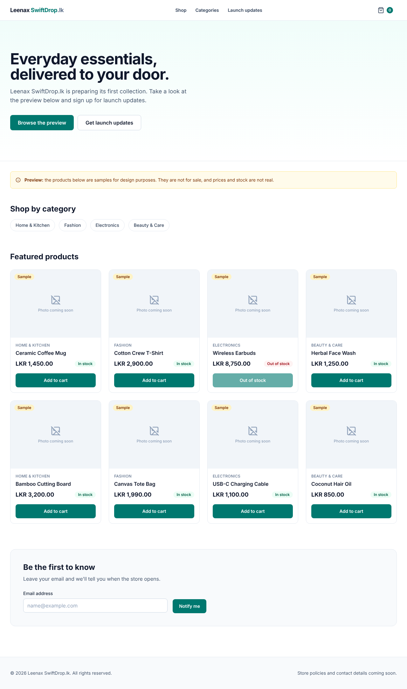
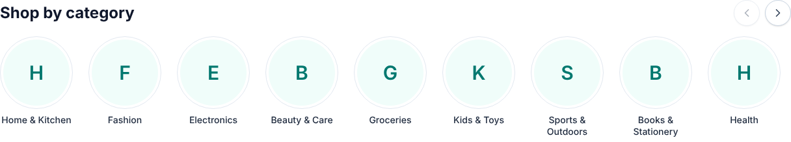

# Phase 2 — React Fundamentals and Design System

Date: 2026-10-28 · Branch: `claude/create-projects-s4blmr`



## A. Implementation summary

**Delivered:** a responsive, accessible storefront home page that works
without the backend. It uses clearly labelled **sample** data and shows
loading, empty, error and success states.

```
frontend/src/
├─ index.css                  design tokens (@theme): brand colours, font, focus style
├─ lib/cn.ts                  joins class names
├─ lib/money.ts               formatMoney(): display-only price formatting
├─ types/catalog.ts           Money, Category, Product types
├─ components/ui/             design system (reusable, no business logic)
│  ├─ Button.tsx, buttonStyles.ts   variants primary/secondary/ghost/danger; sizes; loading
│  ├─ Input.tsx               label, hint, error, all wired for screen readers
│  ├─ Card.tsx, Badge.tsx, Skeleton.tsx
│  └─ EmptyState.tsx, ErrorState.tsx
├─ components/layout/         AppLayout (skip link), Header (mobile menu), Footer, Container
├─ features/catalog/          ProductCard, ProductGrid, ProductImage, CategoryList,
│                             sampleData.ts, useSampleProducts.ts (custom hook)
├─ features/launch/           NotifyMeForm (controlled form + validation)
└─ pages/HomePage.tsx         puts the sections together
```

New dependencies: `lucide-react` (icons) and `@fontsource-variable/inter`
(the Inter font, self-hosted, so no requests go to Google).

### Design decisions

| Decision | Why |
|---|---|
| Tokens in Tailwind `@theme` (`brand-*` = teal) | Change the brand colour in one place. Teal 700 on white passes WCAG AA contrast. |
| `components/ui` (generic) vs `features/*` (store-specific) | UI parts can be reused anywhere; feature folders group everything about one topic. |
| `Money = { amount: string; currency }` | Matches what the backend will send. A string avoids floating-point errors; the browser only *displays* prices. |
| Every sample product has `isSample: true` and a visible **Sample** badge, plus a page banner | Never presents fake stock as real |
| No stock photos | Placeholder ("Photo coming soon") instead of pretending to have real product images |
| Cart count state lives in `App` | Header and product cards both need it ("lifting state up"). Preview only; the real cart is server-side (Phase 8). |
| `useSampleProducts` custom hook with a fake delay | The page already handles loading and error states; Phase 5 swaps the timer for Axios without changing the page. |
| Header links point to page sections (`#products`) | Routing arrives in Phase 4 |
| English only | D-12 (Sinhala and Tamil) is still open. All text is in components and can be moved to translation files later. |

### Preview the screen states in the browser
- `http://localhost:5173/`: normal
- `http://localhost:5173/?demo=empty`: empty state
- `http://localhost:5173/?demo=error`: error state, and "Try again" recovers

## B. Programming lessons

**Components and props.** A component is a function that returns UI.
*Props* are its inputs, like function arguments:
`<ProductCard product={p} onAddToCart={add} />`. A component must never change
its own props.

**State (`useState`).** Data that changes over time and should update the
screen. `const [isMenuOpen, setIsMenuOpen] = useState(false)`. Calling the
setter re-renders the component. Use the updater form
`setCount((count) => count + 1)` when the new value depends on the old one.

**Lifting state up.** When two components need the same data, store it in
their closest common parent and pass it down as props. `App` owns
`cartCount`, `Header` shows it, and `ProductCard` changes it through the
`onAddToCart` callback.

**`useEffect`.** Runs code *after* render, for side effects (timers,
network requests). The dependency array `[attempt, demo]` says when to run it
again. The returned function is the **cleanup**: it cancels the timer if
the component disappears first.

**Custom hooks.** A function starting with `use` that combines hooks:
`useSampleProducts()` returns `{ status, products, retry }`.

**Controlled forms.** The input's `value` comes from state, and `onChange`
updates that state, so React is the single source of truth. `event.preventDefault()` stops the
browser's full-page form submission.

**Lists and keys.** `products.map(...)` renders a list. `key={product.id}`
lets React track items. Use a stable ID, not the array index, for data
that can change.

**Accessibility, as built**
- Semantic landmarks: `header`, `nav aria-label`, `main`, `footer`, `section aria-labelledby`
- Skip link (press Tab on page load)
- Every input has a `<label>`; errors are linked with `aria-describedby` and `aria-invalid`
- `aria-expanded` and `aria-controls` on the menu button
- `role="alert"` on errors and `role="status"` on the form confirmation
- Icons are `aria-hidden`; buttons have meaningful names ("Add Ceramic Coffee Mug to cart")
- A visible focus outline on everything

**Testing with React Testing Library.** Tests find elements the way users do:
`getByRole('button', { name: 'Notify me' })` and `getByLabelText('Email address')`.
If a test can't find an element by role and name, a screen-reader user
probably can't either.

### Problems hit during this phase, and the fixes

1. **7 tests failed: "Found multiple elements with the role button".**
   Components from earlier tests stayed in the DOM. RTL only cleans up
   automatically when Vitest's `globals` mode is on, and we use explicit
   imports. Fix: `afterEach(cleanup)` in `src/test/setup.ts`.
   *Lesson: read the first error carefully. "multiple elements" meant leftovers, not a broken component.*
2. **Lint: `only-export-components`.** `Button.tsx` exported a helper
   function, which breaks Vite's fast refresh. Fix: moved it to `buttonStyles.ts`.
3. **Lint: `purity`.** `Footer` called `new Date()` during render. Render
   functions should be pure (same inputs → same output). Fix: compute the year once at module level.
4. **Cards had different widths** (found in a browser screenshot; all tests
   were green). A flex child shrinks to its content. Fix: `w-full` on the card.
   *Lesson: tests check behaviour, not appearance. Always look at the UI too.*

### Interview-style questions
- What is the difference between props and state?
- Why does `useEffect` return a function?
- What is a controlled component?
- Why should list keys not be array indexes when items can change?
- Why test with `getByRole` instead of CSS class names?

## C. Verification

| Check | Result |
|---|---|
| `npm test` | ✅ 8 files, **21 tests passed** |
| `npm run lint` | ✅ No warnings (after fixes 2 and 3) |
| `npm run format:check` | ✅ |
| `npm run build` (type-check + bundle) | ✅ |
| Chromium screenshots at 1280 px and 390 px | ✅ No horizontal scrolling, no console errors |
| Keyboard | ✅ The first Tab focuses "Skip to main content" |
| Screen states (`?demo=empty`, `?demo=error`) | ✅ Rendered and checked visually |

The backend was not changed. It still passes from Phase 1.

### Known limitations
- Sample data only. Nothing is saved; the cart count resets when the page reloads.
- The "Notify me" form doesn't send or store anything, and says so.
- Links scroll within the page; real pages arrive in Phase 4.
- The header cart link goes nowhere yet (`#cart`).
- No automated accessibility scanner yet (axe). Planned for Phase 11.

## D. Git status
See `docs/PROGRESS.md` and the chat summary.

## E. Exercises

1. **Easy: a new Badge tone.** Add an `info` tone (blue) to `Badge.tsx` and
   use it somewhere. Which TypeScript type must change, and what error do you
   get if you forget?
2. **Intermediate: a "Clear" button.** In `NotifyMeForm`, add a secondary
   button that empties the input and removes the error. Which state values
   must reset? Add a test for it.
3. **Debugging: break it to learn.**
   (a) In `ProductGrid.tsx`, remove `key={product.id}`, run `npm run dev`, and
   find the warning in the browser console (F12). Explain it. Then put it back.
   (b) In `useSampleProducts.ts`, delete `attempt` from the dependency array.
   Open `/?demo=error` and click "Try again". What happens, and why?

## F. Improvements

**Required fixes:** none known.

**Optional**
1. Add `eslint-plugin-jsx-a11y`-style checks, or axe in tests, for automatic accessibility checking (Phase 11).
2. Respect `prefers-reduced-motion` for the skeleton pulse and spinner.
3. Real product photos: decide on photo style and size (square vs 4:3) before Phase 7.

**Design questions for you**
- Do you like the teal brand colour? Changing it means editing about eight lines in `index.css`.
- Hero wording: "Everyday essentials, delivered to your door." Change it to whatever fits your brand.

## H. Change after owner review — category carousel

Requested by the owner: "Shop by category" as round images with the name
below, which can be swiped or moved with Previous/Next buttons.



- `features/catalog/CategoryCarousel.tsx` replaces `CategoryList.tsx`
- `features/catalog/CategoryImage.tsx`: the uploaded image, or the first letter until one exists
- `Category.imageUrl` added (filled by admin upload in Phases 6–7)
- Native horizontal scrolling with snap points (swipe), Previous/Next buttons that disable at each end, keyboard arrow keys, reduced-motion support
- New concepts: **`useRef`** (direct access to a DOM element) and passing JSX as a prop (`header`)
- Tests: 3 new carousel tests (**24 in total**), plus a real-browser check of the buttons, keyboard scrolling and phone layout

**Exercise 4 (carousel):** in `CategoryCarousel.tsx`, change the scroll
distance from 80% to 100% of the visible width. Which feels better, and why
did we keep one item in view?

## G. Next phase preview — Phase 3: Spring Boot REST API and ResponseEntity

Back to Java. You'll learn classes, records, enums, OOP and dependency
injection; the controller → service → repository layers; DTOs;
**`ResponseEntity` and HTTP status codes (200, 201, 204, 400, 404, 409)**;
Bean Validation; and global exception handling.

Phase 3 builds `categories` and `products` tables (Flyway V2 and V3), JPA
entities, repositories, services, REST endpoints, consistent error
responses, OpenAPI/Swagger UI, and unit and integration tests.

**Decision needed before Phase 3:** D-2, whether products have **variants**
such as size and colour (for example, one T-shirt in S/M/L). This changes the
database design, so it's best decided now. Price per variant? Stock per variant?
