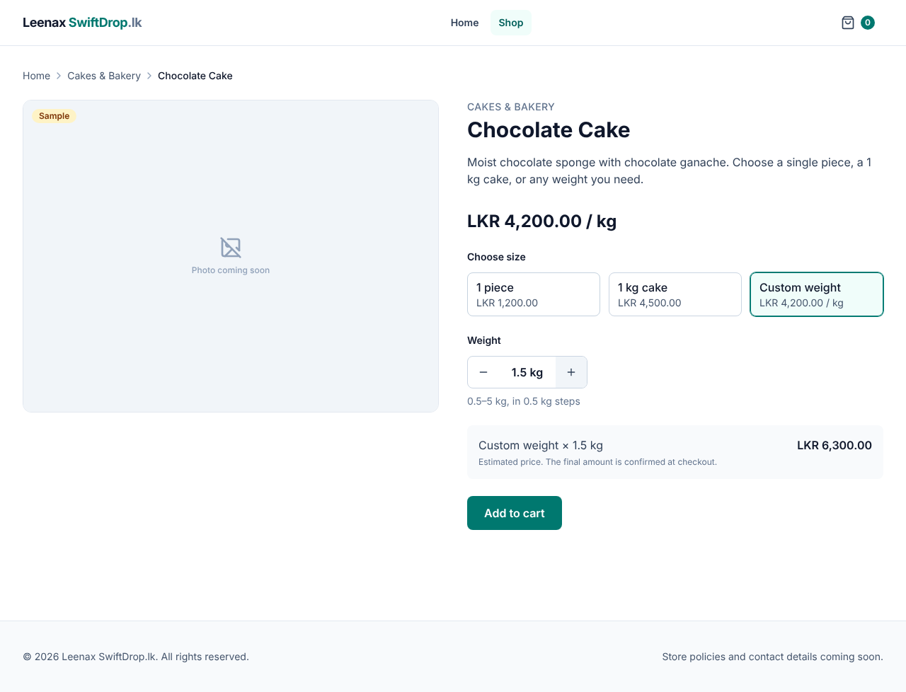
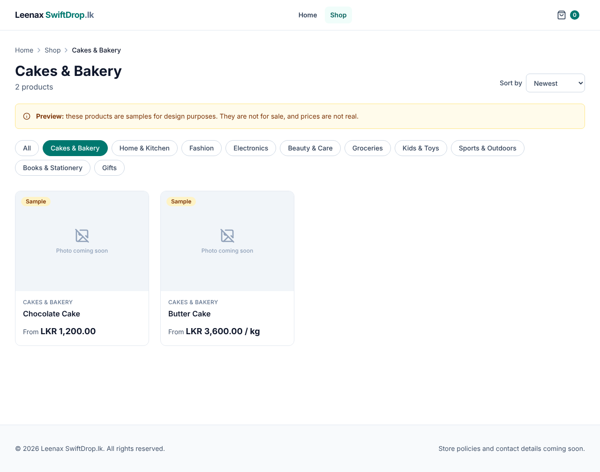

# Phase 4 — React Router and Frontend Navigation

Date: 2026-10-30 · Branch: `claude/create-projects-s4blmr`



## A. Implementation summary

**Delivered:** a multi-page storefront with real URLs, category filtering,
sorting and pagination kept in the URL, a product page where the customer
picks a variant and a quantity or weight, breadcrumbs, and a 404 page. It
uses sample data shaped **exactly** like the Phase 3 API.

| URL | Page | Notes |
|---|---|---|
| `/` | Home | Category carousel (links), 8 newest products, launch form |
| `/products` | Product list | `?category=`, `?sort=newest\|name`, `?page=` (1-based) |
| `/products/:slug` | Product details | Variant choice; quantity or weight stepper; estimated total |
| `/cart` | Cart placeholder | Real cart in Phase 8 |
| `*` | 404 | Inside the normal layout, with links back |
| (any crash) | Error page | `errorElement`: no blank white screen |



### Files

```
frontend/src/
├─ main.tsx                    createBrowserRouter(routes) + RouterProvider
├─ routes.tsx                  the URL map (layout route + child routes)
├─ components/layout/
│  ├─ RootLayout.tsx           layout route: header/footer, <Outlet />, cart count, ScrollRestoration
│  ├─ Header.tsx               NavLink (active page highlighted, aria-current)
├─ components/navigation/      Breadcrumbs, Pagination
├─ pages/                      HomePage, ProductListPage, ProductDetailPage,
│                              CartPage, NotFoundPage, RouteErrorPage
├─ features/catalog/
│  ├─ catalogApi.ts            THE data access module (sample data now; Axios in Phase 5)
│  ├─ sampleData.ts            sample catalogue in the API's exact JSON shape
│  ├─ VariantSelector.tsx      radio buttons styled as cards
│  ├─ QuantitySelector.tsx     − / + stepper honouring min/max/step (pieces or kg)
│  ├─ CategoryFilter.tsx, SampleDataNotice.tsx, variantLabel.ts
├─ hooks/useAsync.ts           loading/success/error + race-condition protection
├─ lib/decimal.ts              exact decimal maths with BigInt
├─ lib/money.ts, lib/quantity.ts, lib/errors.ts
└─ types/catalog.ts            mirrors the backend JSON (Money, Variant, Page, ...)
```

Removed: `App.tsx` (replaced by `routes.tsx` + `RootLayout`), `useSampleProducts.ts` (replaced by `useAsync` + `catalogApi`).
New dependency: `react-router` 8.5.1.

### Design decisions

| Decision | Why |
|---|---|
| Filters, sort and page in the **URL** (`useSearchParams`), not `useState` | Shareable and bookmarkable links; Back/Forward and refresh keep the filters |
| One `catalogApi` module that all pages use | Phase 5 swaps sample data for Axios in **one file**; pages don't change |
| Types copied from the API's JSON shape | The compiler will tell us immediately if the frontend and backend disagree |
| Pagination and filters are real `<Link>`s | Work with middle-click, "open in new tab" and screen readers |
| Product card is one link (stretched over the card) | The whole card is clickable, but screen readers hear just the product name |
| Variant choice uses real radio buttons | Free keyboard support (arrow keys) and correct screen-reader announcements |
| Quantity uses −/+ buttons, not free typing | The customer can only reach allowed values (e.g. 0.5 kg steps). The server re-checks in Phase 8. |
| Estimated total uses BigInt decimal maths | `0.1 * 3` in JavaScript is `0.30000000000000004`; prices must be exact. Labelled "estimated": the server decides the real total. |
| `key={product.id}` on the product view | Moving to another product resets the chosen variant and quantity |
| React 19 `<title>` in each page | Each page gets its own browser tab title with no extra library |

## B. Programming lessons

**Routing basics**
- `createBrowserRouter(routes)` + `<RouterProvider>`: React Router watches the URL and renders the matching route without reloading the page.
- **Layout route:** the `/` route renders `RootLayout`; its `children` render inside `<Outlet />`. The header and footer are written once.
- **Index route** (`index: true`): what shows at exactly `/`.
- **Route parameters:** `products/:slug` matches `/products/chocolate-cake`; `useParams()` returns `{ slug: 'chocolate-cake' }`.
- **Search parameters:** `useSearchParams()` reads and writes `?category=…&page=…`.
- **`*` route:** matches anything else, giving the 404 page.
- **`errorElement`:** shown if rendering crashes.
- **`<Link>` vs `<a>`:** `Link` changes the page without a full reload. Use `<a>` only for in-page anchors (`#launch-updates`) and external sites.
- **`NavLink`:** knows whether it points to the current page (`isActive`) and adds `aria-current="page"`. `end` stops "Home" from matching every URL.
- **`useOutletContext`:** the layout shares `addToCart` with child pages.

**Data loading with `useAsync`**
- Three states: `loading` → `success` or `error` (a TypeScript *discriminated union*: after checking `state.status === 'success'`, TypeScript knows `state.data` exists).
- **Race conditions:** if you click quickly from Cakes to Fashion, the slower Cakes response could arrive last and show the wrong products. The `ignore` flag in the effect cleanup discards stale responses.
- The `key` argument says when to reload (category, sort or page changed).

### Problems hit during this phase, and the fixes
1. **A patch script stopped itself:** my safety check found leftover `href` links because Prettier had reformatted the header. Rewriting the file whole was clearer than patching it. *Lesson: scripts that edit code should verify their result.*
2. **Test: "Found multiple elements with the role status".** The quantity `<output>` element automatically has `role="status"`. Correct HTML; the test now finds the message by its text.
3. **"Shop" wasn't highlighted** (found in a screenshot). Two Tailwind text colours on one element: the winner is decided by CSS order, not class order. Fix: only ever apply one colour.
4. **The product image stretched** to the height of the text column (screenshot). Grid items stretch by default. Fix: `self-start`.
5. **A `//` comment inside JSX** would have been shown on the page as text. JSX comments must be `{/* … */}`. Caught when reviewing the diff, before committing.

### Interview-style questions
- Why keep filters in the URL instead of component state?
- What is a layout route, and what does `<Outlet />` do?
- `<Link>` vs `<a href>`: what's the difference?
- What is a race condition in data fetching, and how do you prevent it?
- Why must a single-page app's server send `index.html` for unknown paths? (See limitations.)

## C. Verification

| Check | Result |
|---|---|
| `npm test` | ✅ **46 tests passed** (11 files; 12 new route tests run the whole app in a memory router) |
| `npm run lint`, `format:check`, `build` | ✅ clean |
| Real browser (Chromium) | ✅ Deep link to a filtered list; card click → product page; **Back** returns to the filtered list; tab titles change; 404; page 2 |
| Console errors | ✅ 0 |
| Phone width (390 px) | ✅ No sideways scrolling ([screenshot](images/phase-4-product-detail-mobile.png)) |
| Backend | Unchanged; 27 tests from Phase 3 |

### Known limitations
- **Still sample data.** Phase 5 connects the real API.
- **Production hosting needs a "fallback to `index.html`"** so that opening `/products/chocolate-cake` directly works (the Vite dev and preview servers already do this). This gets configured with the hosting in Phases 12–14.
- The "From" price compares variant prices as listed, so "From LKR 3,600.00 / kg" (a per-kg price) can appear next to per-piece prices. The unit is always shown, so it's honest, but you may prefer a different rule; see improvements.
- No text search yet.
- The cart count is a preview (it resets on reload).

## D. Git status
See `docs/PROGRESS.md` and the chat summary.

## E. Exercises

1. **Easy: a new page.** Add an `/about` route with a simple "About us" page and a header link to it. Which two files must change?
2. **Intermediate: a page-size option.** Add a "Show 8 / 16" select to the product list that stores `?size=` in the URL. Make sure changing it goes back to page 1, and write a route test.
3. **Debugging: race conditions.** In `useAsync.ts`, delete the line `ignore = true`. In `catalogApi.ts`, temporarily make the delay random (`Math.random() * 2000`). Click quickly between categories. What goes wrong? Put both back.

## F. Improvements

**Required fixes:** none known.

**Optional**
1. Text search box (`?q=`) and a matching backend endpoint.
2. Remember the chosen variant in the URL (`?variant=`), so a link opens the exact size.
3. Decide the "From" price rule for mixed units (e.g. show the cheapest *fixed* item first).
4. Prefetch the product page on hover for faster navigation.

## G. Next phase preview — Phase 5: Axios and backend integration

You'll learn Promises in depth, Axios instances and interceptors, a central
API configuration with environment variables (`VITE_API_URL`), **CORS** and
why browsers enforce it, and consistent error handling for the RFC 9457
problem responses from Phase 3.

Phase 5 replaces the inside of `catalogApi.ts` with real requests, turns
`USING_SAMPLE_DATA` off, adds a narrow CORS configuration (or a Vite dev
proxy) on the backend, and adds integration tests with a mocked HTTP layer.
You'll then see the products you create in Swagger appear in the storefront.
