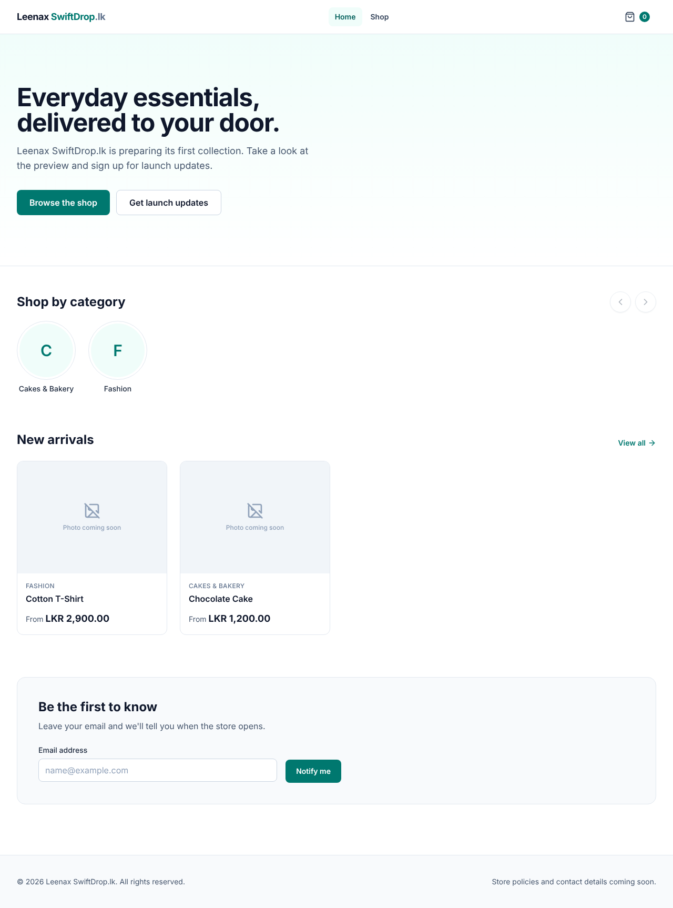

# Phase 5 — Axios and Backend Integration

Date: 2026-10-30 · Branch: `claude/create-projects-s4blmr`



## A. Implementation summary

**Delivered:** the React storefront shows **real** categories and products
from Spring Boot and PostgreSQL. Errors show friendly messages, requests
are cancelled when no longer needed, and the backend allows only the
frontend's origin (CORS).

### Backend
| File | Purpose |
|---|---|
| `config/CorsConfig.java` | Allows `/api/**` calls only from `CORS_ALLOWED_ORIGINS` (default `http://localhost:5173`); exposes `Location` |
| `application.yml` | `app.cors.allowed-origins` from env |
| `.env.example` | Documents `CORS_ALLOWED_ORIGINS` |
| `CorsConfigTest.java` | Preflight from the frontend → allowed; from another site → **403** |

### Frontend
| File | Purpose |
|---|---|
| `api/http.ts` | **The** Axios instance: `baseURL` from `VITE_API_URL`, 10 s timeout, a response **interceptor** turning every failure into `ApiError` / `NotFoundError` |
| `lib/errors.ts` | `ApiError` (status, title, message, field errors), `NotFoundError`, `userMessage()` (safe customer messages) |
| `features/catalog/catalogApi.ts` | Real requests (`/api/categories`, `/api/products`, `/api/products/{slug}`), sort mapping, `AbortSignal` support; sample mode when `VITE_USE_SAMPLE_DATA=true` |
| `features/catalog/sampleCatalog.ts` | The in-memory sample API (moved out of `catalogApi.ts`) |
| `hooks/useAsync.ts` | Now **cancels** stale requests with `AbortController` |
| `pages/HomePage.tsx` | Category section handles empty and failed states |
| `env.d.ts`, `frontend/.env.example` | Typed `VITE_` settings, documented |
| `test/mockApi.ts`, `test/setup.ts` | **MSW** fake backend for tests (sends the same CORS header as the real one) |
| `api/http.test.ts` | Interceptor, error mapping, query parameters, cancellation |

New dependencies: `axios` 1.21 (app), `msw` 3.0 (tests only).

### Design decisions

| Decision | Why |
|---|---|
| One Axios instance, configured once | Base URL, timeout and error handling live in one file. Phase 6 adds login handling there, not in every page. |
| Interceptor converts errors to `ApiError` | Pages never deal with Axios internals or raw server messages |
| `userMessage()` hides 5xx details | Customers never see stack traces or internal errors |
| Direct calls to `:8080` with CORS (not a Vite proxy) | So you learn and test CORS now. Production can serve both from one domain (same origin) in Phase 14. |
| CORS: an explicit list of origins; no credentials yet | Never `*`. Cookies/credentials are decided with login in Phase 6. |
| Cancel requests with `AbortController` | Prevents race conditions *and* saves the user's mobile data |
| `encodeURIComponent(slug)` | A crafted URL can't change which API path is called |
| Sample mode kept behind `VITE_USE_SAMPLE_DATA` | You can still work on the design without starting the backend |
| MSW in tests, not mocking Axios | Tests exercise the real HTTP code, interceptor included |

## B. Programming lessons

**Promises and async/await**
- A **Promise** is a value that arrives later: pending → fulfilled (data) or rejected (error).
- `await` pauses an `async` function until the Promise settles. Rejections become exceptions (`try/catch`).
- `http.get<Page<ProductSummary>>(url)` resolves to a response; `.data` is the parsed JSON, typed by the generic.

**Axios**
- `axios.create({ baseURL, timeout, headers })` makes a configured instance.
- `params: { category, page }` builds the query string and skips `undefined` values.
- **Interceptors** run for every request or response, which is the right place for cross-cutting concerns (errors now, the login token/cookie in Phase 6).
- `signal` (AbortController) cancels a request; the cancellation is not an error to show.

**CORS, in practice**
- The **origin** = scheme + host + port. `http://localhost:5173` and `http://localhost:8080` are different origins.
- For non-simple requests the browser first sends a **preflight** `OPTIONS` asking "may this origin call this?". The server answers with `Access-Control-Allow-*` headers.
- If the answer is no, the browser **hides the response** from JavaScript, and Axios only sees "Network Error". For security reasons, JavaScript can't tell a CORS failure from the server being down; the reason appears only in the browser console (F12).
- CORS protects **users in browsers**. It is **not** API security: curl and Postman ignore it. Login (Phase 6) protects the admin API.

**Environment variables in Vite**
- Only variables starting with `VITE_` reach the browser code (`import.meta.env.VITE_API_URL`).
- They are **built into the public JavaScript**. Never put secrets there.

### Problems hit during this phase, and the fixes
1. **MSW 3 renamed `onUnhandledRequest` to `onUnhandledFrame`.** TypeScript caught it. *Lesson: after a major version bump, check the types and changelog before trusting old tutorials.*
2. **Every test got "Network Error"** even though MSW was intercepting. I proved the cause with a small experiment: jsdom enforces **CORS like a real browser**, and the fake responses had no `Access-Control-Allow-Origin` header. The fix makes the fake backend send the same header as the real `CorsConfig`, and gives the test page the dev server's address. *Lesson: test a hypothesis with a small experiment before changing code.*
3. **Text patches missed** because Prettier had reformatted files. TypeScript reported every miss immediately.
4. **The category section could show skeletons forever** if the request failed (found by code review). It now shows a short message.
5. **My script stopped itself:** `pkill -f` matched the text of its own command. *Lesson: pattern-based killing is risky; prefer stopping by process ID.*

### Interview-style questions
- What is an origin? Why does `localhost:5173` → `localhost:8080` need CORS?
- What is a preflight request?
- Why can't frontend JavaScript tell a CORS error from a network error?
- Is CORS a security feature for your API? Why or why not?
- What are Axios interceptors used for?
- Why are `VITE_` variables never secret?

## C. Verification

| Check | Result |
|---|---|
| Backend `mvn verify` | ✅ **29 tests passed** (2 new CORS tests) |
| Frontend `npm test` | ✅ **53 tests passed** (6 new HTTP tests; all route tests now go through Axios and MSW) |
| Frontend lint, format, build | ✅ clean |
| **Real end-to-end** (browser → React build → Spring Boot → PostgreSQL) | ✅ Categories and products created through the API appear; product page shows DB data; weight pricing works; a DRAFT product shows "Product not found"; exactly 4 API calls; **0 console errors** |
| CORS from a disallowed origin (port 5174) | ✅ Browser blocks it; the page shows the friendly error ([screenshot](images/phase-5-cors-blocked.png)); the console names CORS |

### Known limitations
- **Admin API still has no login** (Phase 6). CORS doesn't change that.
- An empty database shows "No products found". Add products in Swagger UI (example below).
- No images yet (Phase 7).
- No automatic retry or offline caching; the user presses "Try again".

### Quick test data (paste into Swagger UI)
1. `POST /api/admin/categories`: `{"name": "Cakes & Bakery", "slug": "cakes-bakery", "sortOrder": 1}`
2. `POST /api/admin/products` (use the category `id` from step 1):
```json
{"categoryId": "PASTE-ID", "name": "Chocolate Cake", "slug": "chocolate-cake", "status": "ACTIVE",
 "description": "Moist chocolate sponge.",
 "variants": [
   {"sku": "CHOC-1PC", "price": 1200, "options": {"Size": "1 piece"}},
   {"sku": "CHOC-1KG", "price": 4500, "options": {"Size": "1 kg cake"}},
   {"sku": "CHOC-KG", "price": 4200, "saleUnit": "KG", "minQuantity": 0.5,
    "maxQuantity": 5, "quantityStep": 0.5, "options": {"Size": "Custom weight"}}
 ]}
```

## D. Git status
See `docs/PROGRESS.md` and the chat summary.

## E. Exercises

1. **Easy: see CORS with your own eyes.** Start the backend and frontend, open the shop, press **F12**, and look at the **Network** tab. Find the request to `/api/products` and its response headers. Which header lists your origin?
2. **Intermediate: break CORS on purpose.** In the root `.env`, set `CORS_ALLOWED_ORIGINS=http://localhost:9999` and restart the backend. What does the shop show? What does the console say? Why can't the page tell you more? Then remove the line.
3. **Debugging: an interceptor.** Add a *request* interceptor to `api/http.ts` that logs `METHOD url` with `console.debug` (only when `import.meta.env.DEV`). Watch it in the console while you browse. Why would you never log request bodies in production?

## F. Improvements

**Required fixes:** none known.

**Optional**
1. Cache categories (they rarely change) to avoid re-fetching on every page.
2. A request ID header (`X-Request-Id`) linking browser errors to backend logs.
3. Show a "server unreachable" banner once, instead of on each section.

**Security notes for later phases**
- Phase 6 must configure CORS through Spring Security too (otherwise preflights may be blocked by the security filter).
- When cookies are used for login, CORS needs `allowCredentials` with exact origins, and CSRF protection must be on.

## G. Next phase preview — Phase 6: Authentication and administration

You'll learn Spring Security, password hashing (BCrypt/Argon2),
authentication vs authorization, sessions vs tokens, CSRF, role-based
access, and protected frontend routes.

Phase 6 builds: secure admin login (no public admin sign-up), initial admin
creation from configuration, `/api/admin/**` locked to the ADMIN role, an
admin dashboard with category and product management (including variants),
form validation with React Hook Form, and authorization tests. This closes
the "admin API is open" warning from Phase 3.
