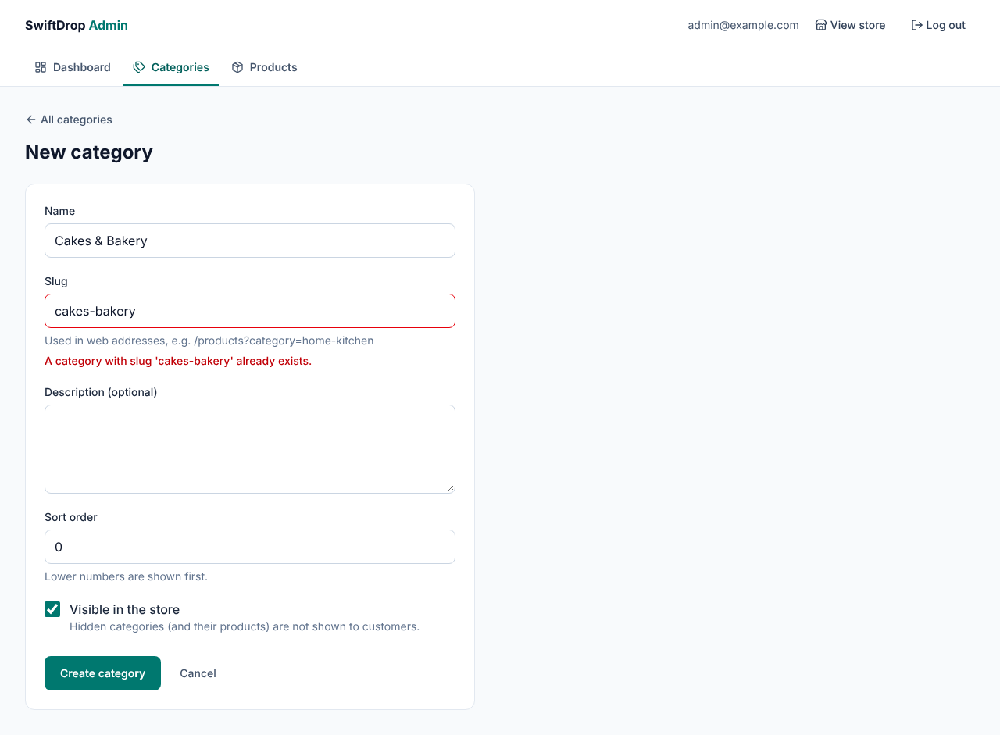
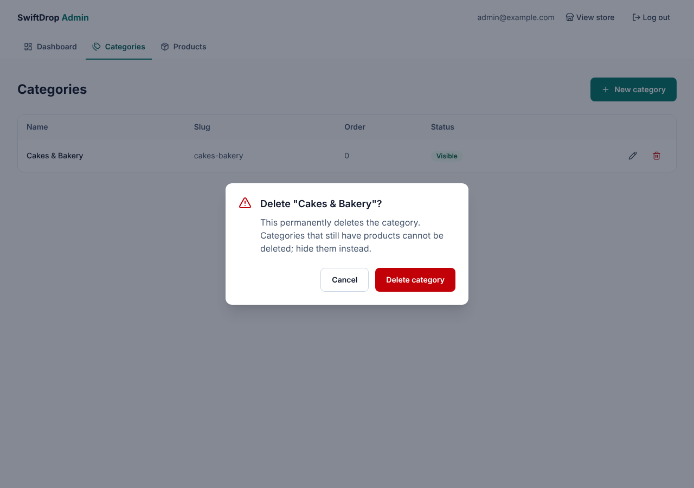

# Phase 6A — Authentication, Authorization and Category Administration

Date: 2026-11-09 · Branch: `claude/create-projects-s4blmr`

Phase 6 is split into two reviewable parts:
- **6A (this report):** security foundation, admin login, category management
- **6B (next):** product, variant and stock management screens; image upload preparation

## A. Implementation summary

**Delivered:** the admin API is no longer open. Only a logged-in ADMIN can
change the catalogue, every change needs a CSRF token, passwords are
stored as bcrypt hashes, and the admin can manage categories in a
protected React admin area.

### Backend
| File | Purpose |
|---|---|
| `V5__create_users.sql` | `users` (lowercase unique email, password hash, enabled) and `user_roles` (ADMIN / CUSTOMER / DELIVERY) |
| `identity/User.java`, `Role.java`, `UserRepository.java` | User entity and roles |
| `identity/AppUserDetailsService.java` | How Spring Security finds a user at login |
| `identity/AdminProvisioner.java` | Creates the **first admin** from `ADMIN_EMAIL` / `ADMIN_PASSWORD` once; refuses passwords under 12 characters; logs no personal data |
| `identity/AuthController.java` | `GET /api/auth/me` |
| `config/SecurityConfig.java` | **All security rules:** URL rules, form login at `POST /api/auth/login`, logout, CSRF (`csrf.spa()`), JSON 401/403 answers, bcrypt |
| `config/CorsConfig.java` | Now a `CorsConfigurationSource` used by Spring Security, with `allowCredentials` and the `X-XSRF-TOKEN` header |
| `application.yml` | Session cookie: HttpOnly, SameSite=Lax, `secure` via `SESSION_COOKIE_SECURE`, 2 h timeout; admin settings; Swagger CSRF |
| `.env.example` | `ADMIN_EMAIL`, `ADMIN_PASSWORD` |

**Access rules** (first match wins):

| Path | Who |
|---|---|
| `/api/admin/**` | ADMIN only |
| `GET /api/categories/**`, `GET /api/products/**` | Everyone |
| `POST /api/auth/login` | Everyone |
| `GET /api/auth/me` | Logged in |
| `/actuator/health`, Swagger, `/error` | Everyone |
| **anything else** | **Denied** (deny by default) |

### Frontend
| File | Purpose |
|---|---|
| `api/http.ts` | `withCredentials` (send the session cookie) and `withXSRFToken` (send the CSRF header) |
| `features/auth/` | `authApi`, `AuthContext` + `useAuth()`, `AuthProvider`, `RequireAdmin` (protected route) |
| `pages/LoginPage.tsx` | React Hook Form + Zod; neutral "incorrect" message; safe redirect back |
| `components/layout/AdminLayout.tsx` | Admin frame: tabs, "View store", "Log out" |
| `pages/admin/` | Dashboard, categories list (table + delete confirmation), category form (new/edit), products placeholder |
| `features/admin/` | `adminCategoryApi`, `categorySchema` (Zod) |
| `components/ui/` | `ConfirmDialog` (accessible), `Textarea`, `Checkbox`, `PageLoading` |
| `lib/slugify.ts` | Slug from name ("Cakes & Bakery" → `cakes-bakery`) |
| `routes.tsx` | `/login` and `/admin/**` are **lazy-loaded** (code splitting) |
| `components/layout/Header.tsx` | "Admin" link for admins |

New dependencies: `spring-boot-starter-security` (+ test), `react-hook-form`, `zod`, `@hookform/resolvers`.

### Design decisions

| Decision | Why |
|---|---|
| **Server-side session + HttpOnly cookie**, not a JWT in `localStorage` | JavaScript can't read an HttpOnly cookie, so an injected script (XSS) can't steal the login. Logging out really ends the session on the server. The frontend and API run on the same site, so cookies just work. |
| **CSRF token** (`XSRF-TOKEN` cookie → `X-XSRF-TOKEN` header) | Cookies are sent automatically, so another site could trigger requests. Only our own pages can read our cookie and copy it into the header. Plus `SameSite=Lax` as a second layer. |
| **Deny by default** (`anyRequest().denyAll()`) | A new endpoint is closed until someone deliberately opens it |
| First admin from `.env`; **no public admin sign-up** | Nobody can register themselves as an admin |
| bcrypt via `DelegatingPasswordEncoder` (`{bcrypt}` prefix) | Slow, salted hashing, with a path to upgrade algorithms later |
| Same message for an unknown email and a wrong password | Attackers can't discover which emails have accounts |
| `RequireAdmin` in React is for **display only** | Real protection is on the server; tests prove the API refuses without login |
| Client validation (Zod) **and** server validation | The client gives instant feedback; the server is the security boundary |
| Server errors shown on the right field (409 → slug) | The admin sees exactly what to fix |
| Lazy-load login/admin pages | The shopper bundle dropped from 557 kB to 420 kB; Zod and the admin code load only when needed |
| Editing a name doesn't change an existing slug | Changing a slug would break links people already shared |

## B. Programming lessons

**Authentication vs authorization**
- *Authentication* = **who are you?** (login: 401 if unknown)
- *Authorization* = **what may you do?** (roles: 403 if not allowed)

**Sessions vs tokens (JWT)**
| | Session cookie (our choice) | JWT in browser storage |
|---|---|---|
| Stored | On the server; the browser only has an id | In the browser |
| Stealable by XSS | No (HttpOnly) | Yes, if kept in `localStorage` |
| Logout | Instant (session destroyed) | Hard (the token is valid until it expires) |
| Needs CSRF protection | Yes | Not if sent in a header |
| Good for | A website and its own API | Many separate services or mobile apps |

**Spring Security concepts:** the filter chain; `SecurityFilterChain`;
`UserDetailsService`; `PasswordEncoder`; `hasRole("ADMIN")` = authority `ROLE_ADMIN`;
`AuthenticationEntryPoint` (401) vs `AccessDeniedHandler` (403); `@WithMockUser`
and `csrf()` in tests.

**React concepts:** Context (`createContext`, `useContext`, a provider); a
protected route component; `<Navigate>`; React Hook Form (`register`,
`handleSubmit`, `setError`, `formState`); Zod schemas and `z.infer` for
types; `React.lazy`-style route `lazy()` and code splitting; managing focus
in a modal dialog.

### Problems hit during this phase, and the fixes

1. **Misplaced `.with(csrf())`:** my regex put it after `perform(...)` on some lines. The compiler caught it. *Lesson: verify automated edits.*
2. **"The browser gets no XSRF-TOKEN cookie"** (a test failure). I first added a filter recommended for **older** Spring Security versions. Then I ran an **experiment**: removed the filter, rebuilt, and checked with `curl`. The cookie was still there, because Spring Security 7 already handles it. **The filter was deleted.** *Lesson: verify version-specific advice; don't keep code that does nothing.*
3. **Why did the test still fail?** MockMvc (a simulation) didn't show the cookie, so I tested over **real HTTP** instead. That test then failed only when run after other tests: MockMvc's `csrf()` helper **replaces the CSRF token store inside the shared test application**. The fix was a separate test class with its own application. *Lesson: test isolation; helpers can change shared state.*
4. **Fake API circular import** (`mockApi` ⇄ `mockAdminApi`). The tests passed, but only by luck. The shared helpers moved to `apiResponses.ts`.
5. **The browser sends a CORS preflight (OPTIONS) before PUT/DELETE.** The fake API didn't answer it; now it does, like the real `CorsConfig`.
6. **Bundle over 500 kB** after adding the form libraries. Fixed with lazy routes (557 kB → 420 kB).
7. **"No HydrateFallback" warning:** one of my two edits hadn't applied, and the script had no check. *Lesson: scripts that edit code must check their own result.*

### Interview-style questions
- What is the difference between authentication and authorization? Between 401 and 403?
- Why store a session id in an HttpOnly cookie instead of a JWT in `localStorage`?
- What is CSRF, and how does the double-submit token pattern stop it?
- Why is checking the role in React not enough?
- Why hash passwords with bcrypt instead of encrypting them?
- Why give the same error for "unknown email" and "wrong password"?

## C. Verification

| Check | Result |
|---|---|
| Backend `mvn verify` | ✅ **40 tests** (11 new: login/logout, roles, CSRF, first-admin creation, cookie over real HTTP; existing admin tests now run as ADMIN with CSRF tokens) |
| Frontend `npm test` | ✅ **69 tests** (16 new: login flow, redirect safety, admin CRUD, validation, server errors on fields, confirm dialog focus) |
| Lint, format, type check, build | ✅ clean; no bundle warning |
| **Browser end-to-end** (React build → Spring Boot → PostgreSQL) | ✅ Logged-out `/admin/categories` → login with return URL; wrong password → neutral message; login → back to categories; session cookie `HttpOnly; SameSite=Lax`; create with auto slug; duplicate slug shown on the field; the new category appears in the store carousel; delete after confirmation; logout → `/api/auth/me` 401; **0 console errors** |
| **Attack checks with curl** | ✅ Forged request (session cookie, no CSRF header) → **403**; with header → 201; not logged in → refused; stored password = `{bcrypt}$2a$10…` |
| Lazy loading | ✅ The home page downloads no admin code; `/admin` loads it on demand; no warnings |

### Known limitations
- ⚠️ **No limit on login attempts yet.** Someone could keep guessing passwords. **Required before going live** (planned: rate limiting / lockout in Phase 11).
- No "forgot password" or password change yet (the admin is created from `.env`).
- Product, variant and stock management screens come in 6B (Swagger works meanwhile, after logging in).
- Category images are still pending (upload form in 6B/7, S3 in Phase 7).
- `SESSION_COOKIE_SECURE` must be `true` in production (HTTPS).

## D. Git status
See `docs/PROGRESS.md` and the chat summary.

## E. Exercises

1. **Easy: see the cookies.** Log in, press F12, open **Application → Cookies → http://localhost:8080**. Which cookie has **HttpOnly** ticked, and why does `XSRF-TOKEN` not?
2. **Intermediate: a new rule.** Make `GET /api/admin/categories` readable by DELIVERY staff too, but nothing else in admin. Write the rule in `SecurityConfig`, then a `@WebMvcTest` with `@WithMockUser(roles = "DELIVERY")` proving GET works and POST is 403. Then **undo it** (it was only an exercise).
3. **Debugging: CSRF by hand.** With `curl`, log in and try `POST /api/admin/categories` without the `X-XSRF-TOKEN` header (you'll get 403), then add the header with the value from the cookie (201). The commands are in this report's verification section; explain each step.

## F. Improvements

**Required before going live**
1. Login rate limiting / temporary lockout after repeated failures.
2. `SESSION_COOKIE_SECURE=true` and HTTPS (Phase 14).
3. Remove `ADMIN_PASSWORD` from the production environment after the first start.

**Optional**
1. "Change password" screen for the admin.
2. Audit log of admin actions (who changed what, when): planned in the architecture.
3. Session timeout warning in the admin UI.

## G. Next phase preview — Phase 6B: products, variants and stock

You'll learn dynamic form arrays (`useFieldArray`) for variants, nested
validation, and the backend API for adding, editing and removing variants.
6B adds stock quantities per variant (pieces or kg) and the admin product
screens: list with filters, create/edit with variants and sale units
(piece/kg with min/max/step), and status changes (draft → active → archived).
It also prepares the image-upload flow for Phase 7.
