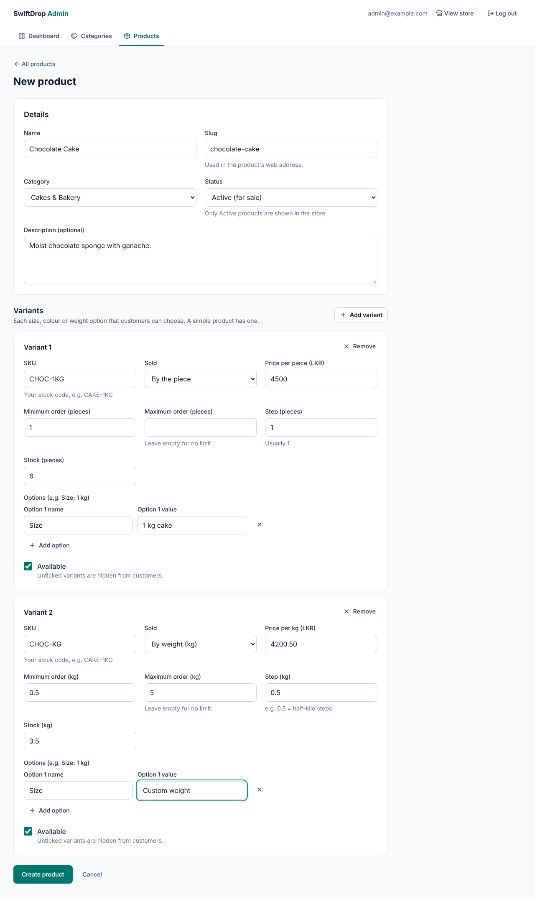
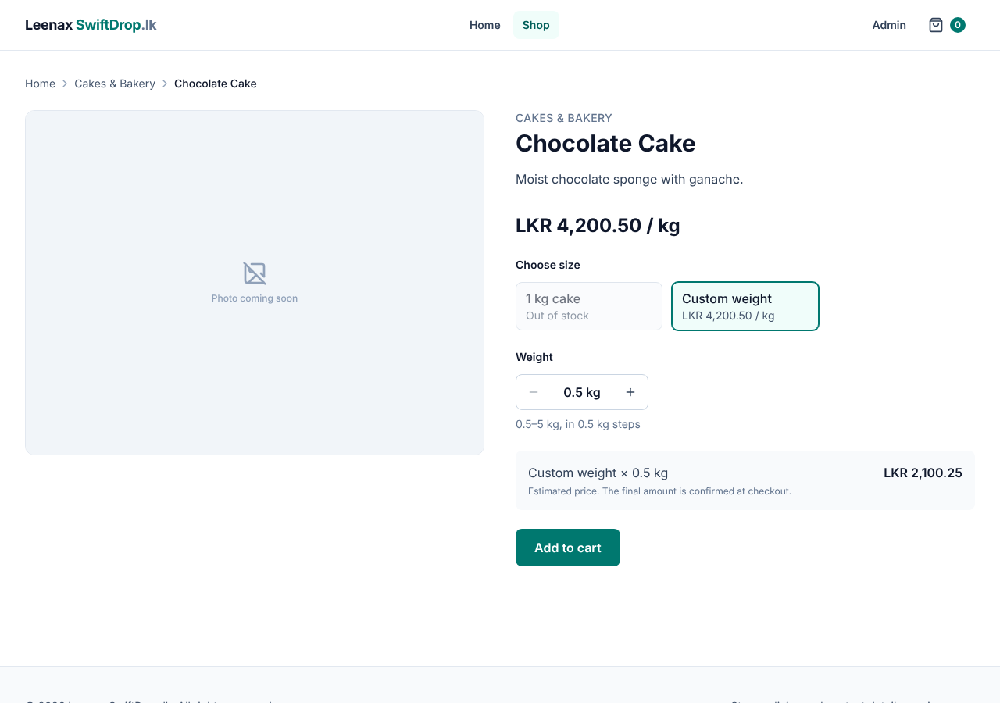
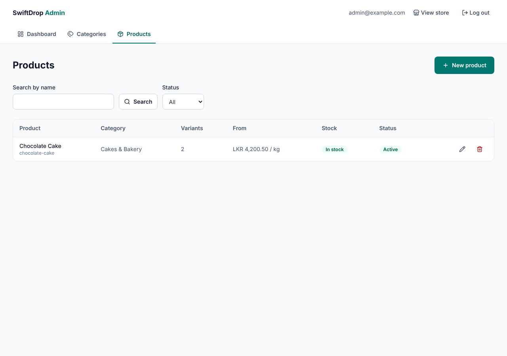

# Phase 6B — Product, Variant and Stock Administration

Date: 2026-11-09 · Branch: `claude/create-projects-s4blmr`

## A. Implementation summary

**Delivered:** the admin can create, search, edit and delete products with
their variants (sizes, colours, or **by weight**) and stock levels. Customers
see "In stock" / "Out of stock", never the exact numbers. This completes
Phase 6.

### Backend
| File | Purpose |
|---|---|
| `V6__add_variant_stock.sql` | `stock_quantity NUMERIC(12,3)` per variant; never negative; whole numbers for PIECE variants. Existing variants start at **0** |
| `ProductVariant.java` | `stockQuantity`, `update(...)`, `isInStock()` (stock ≥ minimum order) |
| `Product.java` | `removeVariantsExcept(...)`, `isInStock()` |
| `VariantRequest.java` | Optional `id` (edit an existing variant) and `stockQuantity`; PIECE stock must be whole |
| `ProductRequest.java` | Used for **both** create and update (`ProductUpdateRequest` removed); rule: an ACTIVE product needs an active variant |
| `ProductService.update` | **One transaction:** updates variants with an id, adds new ones, removes missing ones; rejects variant ids from other products (**IDOR protection**); SKU check against *other* products only |
| `ProductRepository.searchForAdmin` | Admin list with `?q=` (name search, LIKE wildcards escaped) and `?status=` |
| `AdminProductResponses.java` | Admin-only responses (exact stock, inactive variants), **kept separate** from public responses |
| `ProductResponses.java` | Public: adds `inStock` to products and variants; never the stock number |

**API changes**

| Endpoint | Change |
|---|---|
| `GET /api/admin/products?q=&status=&page=&size=&sort=` | Search and status filter; returns `AdminProductSummary` |
| `GET /api/admin/products/{id}` | Returns `AdminProductDetail` with `stockQuantity` per variant |
| `PUT /api/admin/products/{id}` | **Now includes the variant list** (same body as POST) |
| `GET /api/products`, `/api/products/{slug}` | New `inStock` fields |

### Frontend
| File | Purpose |
|---|---|
| `pages/admin/AdminProductsPage.tsx` | Table with search, status filter and pagination **in the URL**; delete with confirmation |
| `pages/admin/AdminProductFormPage.tsx` | Create/edit with a **dynamic list of variants** (`useFieldArray`), each with a **dynamic list of options**; sale-unit-aware labels and defaults; server errors placed on fields |
| `features/admin/productSchema.ts` | Zod rules with cross-field checks (max ≥ min, whole pieces, unique SKUs, active variant needed) using exact decimal maths |
| `features/admin/adminProductApi.ts` | Admin product API; prices and quantities sent as **exact decimal strings** |
| `components/ui/Select.tsx` | Accessible dropdown |
| Storefront | "Out of stock" badge on cards; out-of-stock choices disabled on the product page; first *available* choice preselected |

### Design decisions

| Decision | Why |
|---|---|
| Update product + variants in **one PUT / one transaction** | The form saves everything or nothing; no half-saved products if one variant fails |
| Variant ids must belong to the product (else 404) | Prevents **IDOR**: editing another product's data by sending its id |
| Remove deleted variants and **flush** before adding new ones | Lets a new variant reuse a removed variant's SKU in the same save (the database checks uniqueness per statement) |
| Separate admin and public response types | Exact stock and drafts can't leak to customers by accident |
| "In stock" = stock ≥ minimum order quantity | 0.25 kg left of a cake with a 0.5 kg minimum can't actually be bought |
| Prices and quantities sent as strings | `"4200.50"` stays exact; the backend reads it as `BigDecimal` (tested) |
| Search text escaped for LIKE | A search for "100%" finds "100%", instead of `%` acting as a wildcard |
| Stock edited in the product form (no separate inventory page yet) | The smallest useful version; reservations and movements come with orders (Phase 8) |

### Image upload: prepared design (built in Phase 7)
1. The admin chooses an image in the product form.
2. The frontend asks the backend for a **pre-signed upload URL** (`POST /api/admin/products/{id}/images/upload-url`, with file type and size). The backend checks the admin, the type (JPEG/PNG/WebP) and the size limit.
3. The browser uploads **directly to a private S3 bucket**. The server never handles the file bytes, and no AWS keys are in the browser.
4. The frontend confirms; the backend stores the image record (`product_images`: key, alt text, order).
5. Customers get images through short-lived signed URLs (or a CDN later).

## B. Programming lessons

- **`useFieldArray`:** form lists that grow and shrink; use `field.id` as the React key, never the array index.
- **Nested field arrays:** options inside variants (`variants.${index}.options`).
- **`useWatch`:** re-render one part of a form when one field changes (the sale unit).
- **Cross-field validation:** Zod `superRefine` with issues on exact paths (`variants.1.sku`).
- **Mapping server field errors:** `variants[0].price` (server) → `variants.0.price` (form).
- **JPA collections:** `orphanRemoval`, updating an `@ElementCollection` in place, and why `flush()` order matters.
- **IDOR:** always check that an id in a request belongs to the resource being changed.
- **Accessibility:** a `<legend>` must be the *first child* of its `<fieldset>` to name the group.

### Problems hit during this phase, and the fixes
1. **"Variant 1" group not found** (a test). A real accessibility bug: the `<legend>` was inside a `
`, so the group had no name for screen readers. Fixed with the legend as the first child.
2. **"Cakes & Bakery" not found in options** (a test). user-event compares option text as HTML (`&amp;`). Fixed by choosing by value; the comment in the test explains it.
3. **Two edit scripts didn't apply** (Prettier had reformatted files). Both were caught by built-in checks (an assertion and a "replaced 0" count) before any wrong code ran.

### Interview-style questions
- What is IDOR, and how does this API prevent it?
- Why update a product and its variants in one transaction?
- Why might deleting and inserting rows with the same unique value fail in one transaction, and how does `flush()` help?
- Why keep separate DTOs for admin and public APIs?
- Why use `field.id` rather than the index as a React key in `useFieldArray`?
- How do you stop `%` in a search box from acting as a LIKE wildcard?

## C. Verification

| Check | Result |
|---|---|
| Backend `mvn verify` | ✅ **47 tests** (7 new: one-request variant changes incl. SKU reuse, **IDOR attempt → 404**, stock never public, stock rules, active-variant rule, string decimals, admin search with literal `%`) |
| Frontend `npm test` | ✅ **79 tests** (10 new: create with piece + kg variants, validation, edit + remove in one save, SKU conflict, URL search, out-of-stock choices, schema rules) |
| Lint, format, types, build | ✅ clean |
| **Browser end-to-end** (React → Spring Boot → PostgreSQL) | ✅ Log in → create category → create "Chocolate Cake" with a 1 kg cake (pieces) and custom weight (LKR 4,200.50/kg, max 5 kg) through the form → list shows "LKR 4,200.50 / kg, In stock, Active" → store shows 1 kg = LKR 4,200.50 → set the 1 kg cake's stock to 0 → store disables it and preselects custom weight → public API has no `stockQuantity` |

### Known limitations
- **Existing variants start with stock 0** after migration V6 (shown as out of stock). Enter real stock in the admin form.
- Stock is not yet reduced by orders, and there's no stock history (Phase 8: reservations; later: an inventory log).
- No product images yet (Phase 7, design above).
- Swapping SKUs between two existing variants in one save may be refused (409). Change one, save, then the other.
- Login rate limiting is still required before going live (from 6A).

## D. Git status
See `docs/PROGRESS.md` and the chat summary.

## E. Exercises

1. **Easy: stock in the store.** Create a product with one variant and stock 0. Check the store, then set stock to 5. What changes, and what never appears in the public API (`/api/products/{slug}`)?
2. **Intermediate: a low-stock badge.** In the admin product list, show a "Low stock" badge when a product is in stock but every active variant has less than 3. (Hint: add `lowStock` to `AdminProductSummary` in Java, then the badge in React.) Write one backend test.
3. **Debugging: IDOR.** In Swagger, create two products. Send a `PUT` for product A whose variant list contains product B's variant id. Which status do you get? Find the line in `ProductService.update` that stops it, and explain what would happen without it.

## F. Improvements

**Required before going live** (unchanged): login rate limiting; HTTPS with secure cookies.

**Optional**
1. Low-stock alerts (exercise 2) and a quick "adjust stock" action in the list.
2. Product duplication ("copy this cake to make a new flavour").
3. An inventory history table (who changed stock, when, by how much).
4. Optimistic-locking feedback in the UI (send `version`, show "someone else changed this product").

## G. Next phase preview — Phase 7: AWS S3 product images

You'll learn object storage, S3 buckets and keys, IAM users vs roles and
least privilege, the AWS SDK for Java 2.x, pre-signed URLs, and secure
upload validation. **Before anything is created in AWS** you'll get the
architecture, the services involved, the expected cost (S3 is very cheap
at this scale, but it isn't free), and the steps to set up a billing alert,
and nothing is created without your approval. Local development and tests
will run without real AWS credentials (using an S3-compatible test container).
