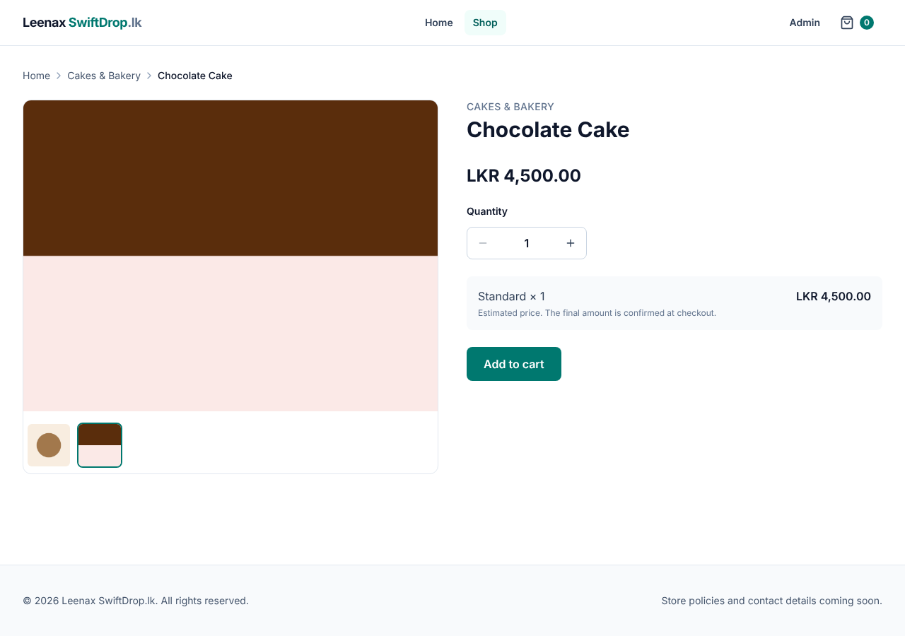
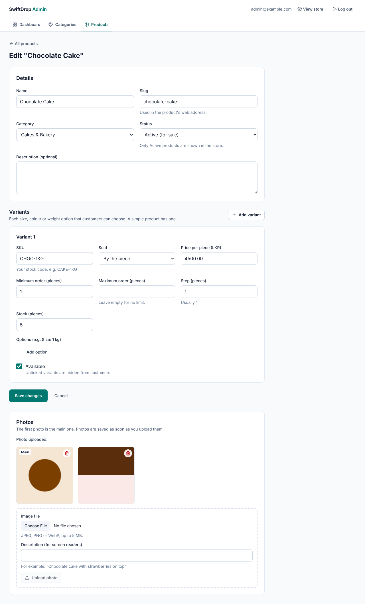

# Phase 7 — Product and Category Images (S3)

Date: 2026-11-09 · Branch: `claude/create-projects-s4blmr`



## A. Implementation summary

**Delivered:** the admin uploads product photos (up to 10, with descriptions)
and round category pictures; the store shows them. Images are stored in S3
through the **AWS SDK for Java 2.x**. Locally and in tests they go to **S3Mock**,
an S3-compatible server, so no AWS account or keys are needed yet.

> **Real AWS is not connected yet: that needs your approval.** See
> [`docs/AWS_SETUP.md`](../AWS_SETUP.md) for the services, the cost estimate
> (well under USD 1/month at launch scale), the budget alert and the
> least-privilege IAM policy. Nothing has been created in your AWS account.

### How an upload works
```
Admin's browser ──multipart/form-data──▶ Spring Boot
   (file + CSRF token + session)          1. ADMIN? CSRF ok?          (Spring Security)
                                          2. ≤ 5 MB?                  (server limit + app check)
                                          3. real JPEG/PNG/WebP?      (first bytes, not the name)
                                          4. key = products/{id}/{random-uuid}.jpg
                                          5. PUT to S3 (private bucket)
                                          6. save row in product_images
                                             (if this fails → delete the S3 file again)
Store visitor ◀──  ── S3
```

### Backend
| File | Purpose |
|---|---|
| `pom.xml` | AWS SDK BOM 2.57.11 + `s3` module |
| `V7__create_product_images.sql` | `product_images` (key, type, size, alt text, order); `categories.image_object_key` |
| `media/ImageType.java` | Detects JPEG/PNG/WebP by **magic bytes**; everything else (including SVG) refused |
| `media/ImageStorage.java`, `S3ImageStorage.java` | Storage interface + S3 implementation (put, delete, **pre-signed GET URL**) |
| `media/ImageUploads.java` | Shared steps: checks, random key, store; **delete after commit**; undo on failure |
| `config/StorageConfig.java` | S3 client/presigner. Local endpoint → path-style + dummy credentials; real AWS → AWS CLI profile or IAM role. **No keys in configuration** |
| `catalog/product/ProductImage.java`, `ProductImageService.java`, `AdminProductImageController.java` | Upload (`POST …/images`, 201) and delete (`DELETE …/images/{id}`, 204) with the 10-photo limit and **IDOR protection** |
| `catalog/category/*` | `PUT/DELETE /api/admin/categories/{id}/image`; old files removed on replace/delete |
| Responses | Public: `imageUrl` (cards), `images[]` (product page), category `imageUrl`; admin: images with ids |
| `application.yml`, `.env.example`, `docker-compose.yml` | Upload limits; S3 settings; **S3Mock service with a volume** |

### Frontend
| File | Purpose |
|---|---|
| `features/admin/imageApi.ts` | Multipart uploads with **progress** (`onUploadProgress`) |
| `features/admin/ImageUploader.tsx`, `imageFile.ts` | File picker, quick type/size checks, alt text, progress bar |
| `features/admin/ProductImagesSection.tsx` | Photo grid, "Main" badge, delete with confirmation |
| `features/admin/CategoryImageSection.tsx` | Round preview, upload/replace/remove |
| `features/catalog/ProductGallery.tsx` | Main photo + thumbnails on the product page |
| `ProductCard.tsx` | Shows the main photo |



### Design decisions

| Decision | Why |
|---|---|
| Upload **through the backend**, not straight to S3 (changed from the 6B sketch) | The server can inspect the file's real content before storing it, and no S3 CORS rules are needed. Images are small, so the extra hop is cheap. |
| **Private bucket + pre-signed URLs** (1 hour) | Nothing is public; a link works only for one file, for a short time |
| Detect type by **magic bytes**; refuse SVG | File names and Content-Type headers are chosen by the uploader and can lie; SVG can carry scripts |
| Random **UUID keys** | No path tricks (`../`), no personal file names, no overwriting |
| Store-then-save with undo; delete **after commit** | The database never points to a missing file; a failed save leaves no stray file |
| Size checked by the web server **and** the app | Defence in depth (MockMvc doesn't run the web server's check; see problems) |
| `Cache-Control: immutable` on objects | Keys never change, so browsers (and a CDN later) can cache for a year |
| Credentials only from an AWS profile or IAM role | Secrets never in code, `.env`, or Git |
| S3Mock for development and tests | Free, no account, runs in Docker, the same S3 API |

## B. Programming lessons

- **Object storage:** buckets, keys ("paths" are just names), objects, and metadata.
- **AWS SDK v2:** `S3Client` (put/delete), `S3Presigner` (signed URLs are computed locally), the region, the credentials provider chain, `endpointOverride` + path-style for S3-compatible servers.
- **IAM:** users vs roles; least-privilege policies (`docs/AWS_SETUP.md`).
- **Multipart uploads:** `MultipartFile` in Spring, `FormData` in the browser (never set the boundary by hand), upload progress events.
- **Validating files safely:** magic bytes, size limits, refusing SVG, random names.
- **Consistency across two systems** (database + S3): compensate on failure; act after commit (`TransactionSynchronization`).
- **Testing:** an S3 container wired in with `DynamicPropertyRegistrar`; downloading the pre-signed URL in a test to prove the bytes are stored.

### Problems hit during this phase, and the fixes
1. **Docker Hub rate limit** for the S3Mock image in the cloud session. A mirror was used for this machine only; your PC and GitHub Actions use Docker Hub normally.
2. **The 6 MB upload "succeeded" in a test.** MockMvc doesn't run Tomcat's upload limit. I added the same check in the application (defence in depth) and verified the real server's limit with `curl` (413).
3. **Upload tests: the fake API saw no file.** `file instanceof File` is false across **realms**: jsdom and Node.js each have their own `File` class. The fix checks the value's shape instead. *Lesson: `instanceof` only works within one JavaScript realm.*
4. **Three edit scripts missed** because Prettier had reformatted lines; each was caught by an assertion before anything wrong ran.

### Interview-style questions
- Why keep the bucket private and use pre-signed URLs?
- Why check magic bytes instead of the file extension or Content-Type?
- What is the difference between an IAM user and an IAM role? Why prefer roles on servers?
- How do you keep a database and S3 consistent when one of them fails?
- Why is SVG upload dangerous?
- What does `forcePathStyle` do, and when do you need it?

## C. Verification

| Check | Result |
|---|---|
| Backend `mvn verify` | ✅ **56 tests** (9 new: upload → pre-signed download returns the **exact bytes**; fake PNG/empty refused; 413; 10-photo limit; **IDOR delete → 404**; deleted files really gone; product delete removes files; category picture replace/remove) |
| Frontend `npm test` | ✅ **84 tests** (5 new: upload with alt text, client-side type/size checks, server rejection shown, delete with confirmation, category picture) |
| Lint, format, types, build | ✅ clean |
| **Browser end-to-end** (React → Spring Boot → PostgreSQL + S3Mock) | ✅ Category picture shown in the store's circle; two product photos uploaded; product card photo loads; gallery switches photos; links are pre-signed (1 h); **0 console errors** |
| **Real HTTP checks (curl, as admin)** | ✅ 6 MB → **413** from the web server; SVG renamed `.png` → **400**; no login → refused; stored as `products/{id}/{uuid}.jpg` with `image/jpeg` and `immutable` caching |
| Local persistence | ✅ Files survive an S3Mock restart (Docker volume) |
| Bucket privacy | ⏳ **Can only be proven on real AWS** (S3Mock doesn't enforce permissions): `docs/AWS_SETUP.md` step 6 |

### Known limitations
- **Real AWS not connected** (awaiting approval).
- Photos can't be reordered or have their descriptions edited yet (delete and re-upload).
- Images are stored as uploaded: no resizing, compression or **EXIF metadata removal** (phone photos may contain GPS location). Recommended before launch.
- Pre-signed links change on each page load, so browsers re-download images more often than ideal. A CDN (CloudFront) in Phase 14 fixes this.
- If deleting a file from S3 fails after a commit, the file is left over (logged); a periodic clean-up job could remove such files.

## D. Git status
See `docs/PROGRESS.md` and the chat summary.

## E. Exercises

1. **Easy: look inside S3Mock.** Upload a photo, then open `http://localhost:9090/swiftdrop-images` in the browser (S3Mock lists the bucket). Find your file's key. Why is it a UUID and not your file name?
2. **Intermediate: reorder photos.** Add `PUT /api/admin/products/{id}/images/order` taking a list of image ids, saving the new `sort_order`. Validate that the list contains exactly this product's images (think about IDOR). Write an integration test.
3. **Debugging: magic bytes.** Rename a `.txt` file to `.jpg` and upload it. Read the 400 response. Then open a real JPEG in a hex viewer (e.g. VS Code's Hex Editor extension) and find the first three bytes. Match them with `ImageType.java`.

## F. Improvements

**Required before going live**
1. Strip EXIF metadata (privacy) and resize/compress images.
2. Connect real S3 with the least-privilege policy, and later replace keys with an IAM role (Phase 14).
3. Still open from before: login rate limiting; HTTPS with secure cookies.

**Optional**
1. Reorder photos and edit descriptions.
2. CloudFront for cached, fast image delivery.
3. A clean-up job for orphaned files.

## G. Next phase preview — Phase 8: shopping cart and checkout (Cash on Delivery)

You'll learn database transactions in depth, stock **reservation** under
concurrency (two customers, one cake left), exact money calculations on the
server, delivery fees, and **idempotency** (a double-click must not create
two orders). Phase 8 adds customer accounts, addresses, the cart (server-side,
including weights like 1.5 kg), checkout validation, order creation with
**price and address snapshots**, and Cash on Delivery.

**Decisions needed before Phase 8** (from `REQUIREMENTS.md`):
D-3 delivery countries at launch, D-4 how delivery fees are calculated,
D-5 where COD is allowed, D-8 guest checkout or accounts only, and D-9 tax/VAT.
