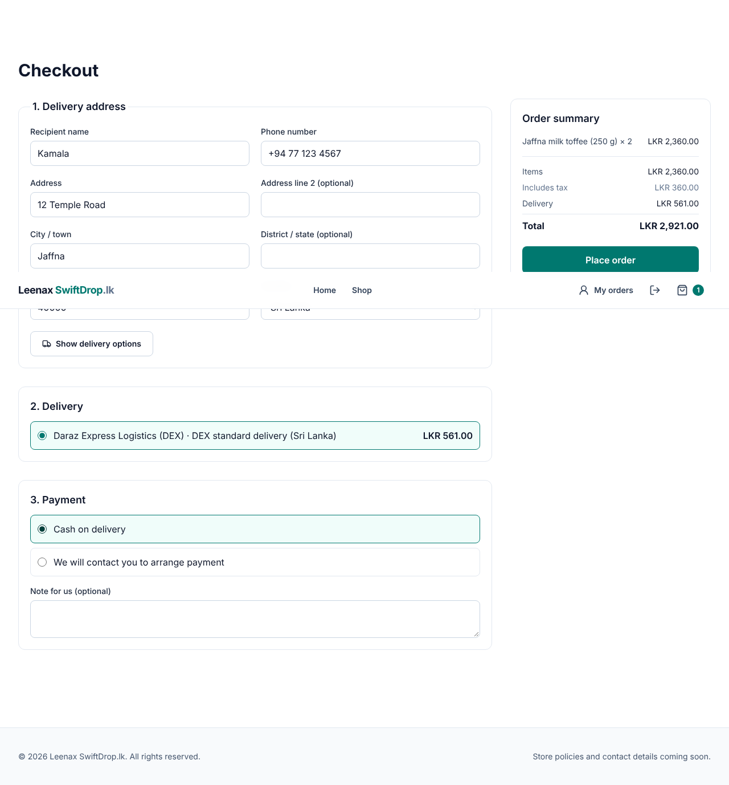
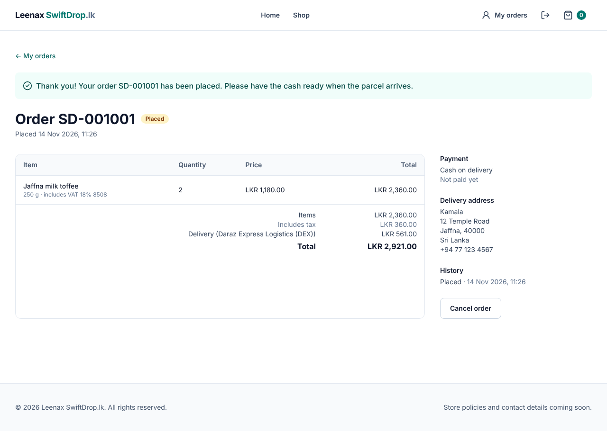
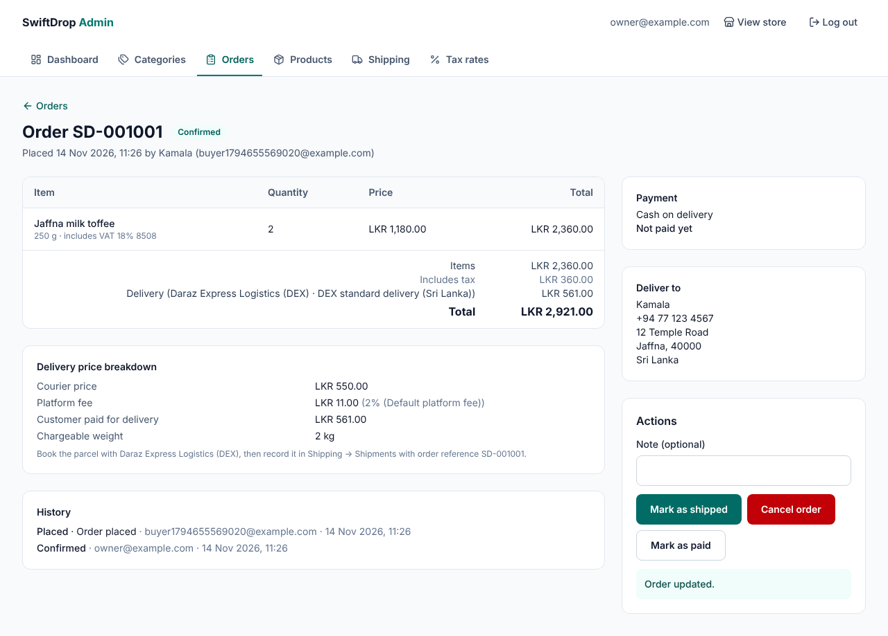

# Phase 8 — Shopping cart, checkout and orders

**Status:** Awaiting owner review · **Date:** 2026-11-14 · **Branch:** `claude/create-projects-s4blmr`

## Owner decisions (2026-11-14)

| # | Decision | How it is built |
|---|---|---|
| D-3 | Countries with Tamil communities | Sri Lanka + 17 countries (IN, CA, GB, AU, CH, DE, FR, NO, MY, SG, US, NZ, DK, NL, IT, SE, AE); the admin edits the list in Shipping → Country restrictions |
| D-5 | COD sometimes, Sri Lanka only, mostly off | Per product "Cash on delivery allowed" (default **off**). COD is offered only for Sri Lanka addresses and only when **every** product in the order allows it. Otherwise the order is placed and **the owner contacts the customer to arrange payment** |
| D-8 | No guest checkout | Customers sign up (`POST /api/auth/register`, always CUSTOMER) and log in before checkout |
| D-9 | Tax configured by the admin | Prices **include** tax. The admin creates tax rates (Admin → Tax rates) and picks one per product; orders show "includes tax" per line and in total |

## A. What was built

**Backend**
- `V12__create_tax_destinations_orders.sql`:
  - `tax_rates`
  - `products.tax_rate_id` and `products.cod_allowed`
  - `shipping_destinations`
  - `orders`, `order_items`, `order_status_events`
  - the `order_number_seq` sequence: order numbers look like `SD-001001`
- **Cart pricing:** `POST /api/cart/price` (public).
  - The browser sends only variant ids and quantities.
  - The server answers with names, prices, the tax included, stock problems and quantity rules. A deleted or hidden product gets the same "no longer available" answer.
- **Checkout:** `POST /api/orders` (CUSTOMER), with an `Idempotency-Key` header.
  1. It checks the products and the allowed quantities.
  2. It checks that the delivery quote is still valid (not expired, same country), then **prices the delivery again** for exactly these items. If the price changed → 409 "please review".
  3. It checks the COD rules.
  4. It **takes the stock atomically**: `UPDATE … WHERE stock >= qty`, in a fixed order. If any item is short, the whole order is rolled back.
  5. It saves **snapshots** of prices, tax, delivery (courier price, fee, rule) and the address.
  6. The same key sent again returns the same order (200, not a second order).
- **Customers:**
  - `GET /api/orders` and `/api/orders/{number}`: their own orders only; another customer's number → 404.
  - Cancel while still PLACED. Cancelling returns the stock.
- **Admin:**
  - Orders: search, detail with the delivery cost breakdown.
  - Status steps: PLACED → CONFIRMED → SHIPPED → DELIVERED, or CANCELLED before shipping, which returns the stock.
  - Mark as paid.
  - Tax rates CRUD; a rate used by products can't be deleted.
  - Countries we deliver to (audited).
- The quote engine now refuses countries we don't deliver to.
- **Fix found by the browser tests:** CORS didn't allow the `Idempotency-Key` header, so a real browser would have blocked "Place order". It's fixed, and a test was added.

**Frontend**
- **Cart:** kept in this browser (local storage, ids and quantities only), synced between tabs, priced by the server, with quantity steppers and stock messages. The header shows the item count.
- **Log in** (customers and admins) and **Create an account**, both returning to the page the customer came from.
- **Checkout** (customers only):
  1. address;
  2. delivery options;
  3. payment: COD only when allowed;
  4. summary with exact totals.

  One idempotency key per checkout, and a clear message when prices changed.
- **My orders:** a list, and an order page with history and "Cancel order".
- **Admin:** Orders (list, order page with actions and the delivery breakdown), Tax rates, tax rate and COD on the product form, and "Countries we deliver to".

## B. Lessons
- **Never trust the browser's price:** the cart and checkout re-price everything on the server. An old or edited cart can't change a price.
- **Idempotency key:** a random id per checkout turns "clicked twice" into "the same order", not two orders.
- **Atomic stock:** "check then subtract" in two steps lets two customers buy the last item. One conditional `UPDATE` can't.
- **Snapshots:** a placed order keeps its prices even if products, tax rates, rate cards or the fee change later.
- **CORS also covers custom headers:** an end-to-end test with real browser rules found what unit tests could not.

## C. Verification
- **Backend `mvn verify`: 124 tests.** New ones:
  - 11 order integration tests: sign-up (no admin through sign-up), cart pricing with tax, a COD order with snapshots and stock, idempotent repeat, the COD rule, the all-or-nothing stock rollback, a changed delivery price → 409, privacy (404 for another customer's order, 403 on admin), customer cancel returns stock, admin steps and payment, destinations, address/key validation, a tax rate in use;
  - tax formula unit tests;
  - the CORS preflight test.
- **Frontend: 127 tests.** Lint, types, format and build are clean.
- **Browser end-to-end** (PostgreSQL; V12 applied on an existing database):
  - a new customer added 2 × LKR 1,180 (VAT 18%) to the cart, was asked to log in, signed up and came back to checkout;
  - entered a Jaffna address, got DEX LKR 561, chose COD and placed SD-001001 for **LKR 2,921**;
  - the cart emptied and stock went from 5 to 3;
  - the owner saw courier LKR 550 + fee LKR 11 and confirmed the order;
  - no console errors, and no sideways scrolling at phone width.

## D. Git
Commits:
- `0d26f82`: backend
- `1b29314`: frontend + CORS fix
- the docs commit after them

On your PC: `git pull`, restart the backend (V12 runs on its own), then `npm install` is not needed (no new packages).

## E. Exercises
1. Create the tax rate your accountant gives you, set it on a product, and check "includes tax" in the cart.
2. Turn on "Cash on delivery allowed" for one product only. Put it in a cart with a product that doesn't allow COD and see the payment options at checkout.
3. Place an order, then open it as the owner. Compare what the customer sees with what you see (courier price and fee).

## F. Limits and what comes next
- **Online card payment:** master Phase 9 (provider decision D-6).
- **Links between orders and shipments:** the admin records the shipment with the order number for now; Shipping Phase F links them.
- **Not built yet:** emails (order confirmation), address book, login rate limiting (Phase 11, required before going live), clean-up of unused quotes (Phase F).
- **Tax on delivery charges** is not calculated. Ask your accountant whether delivery is taxable.

## G. Next
Next in the approved order is **Shipping Phase F** (shipments linked to orders, tracking and expenses). Master Phase 9 (online payments) needs decision D-6 first.
