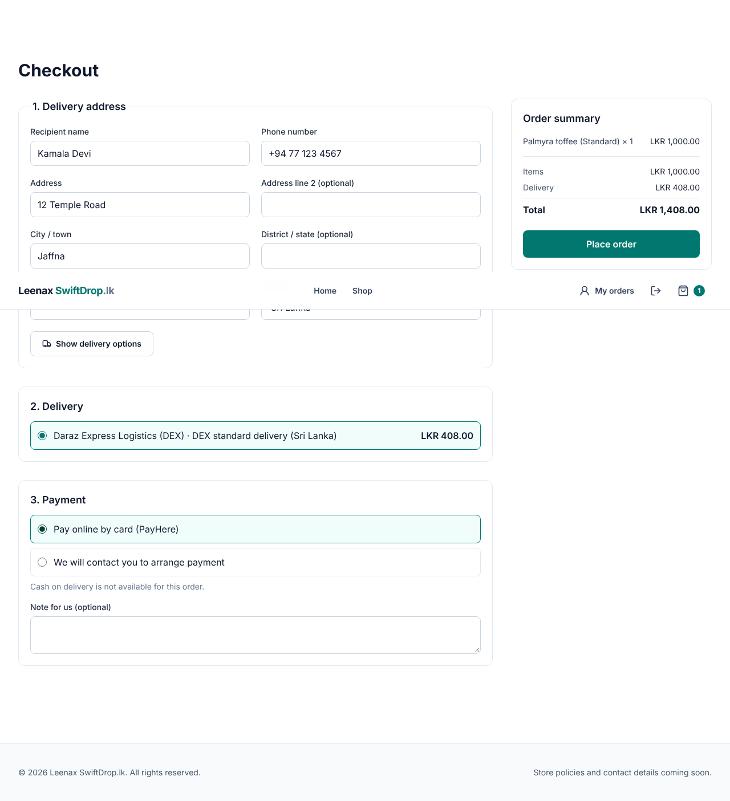
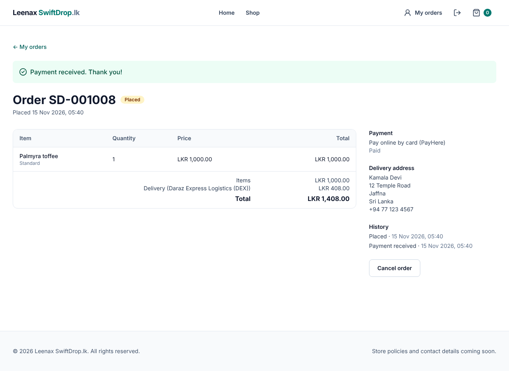

# Phase 9 — Online card payments (PayHere)

**Status:** Awaiting owner review · **Date:** 2026-11-15 · **Decision D-6:** PayHere

## A. What was built
- **Source:** the official PayHere Checkout API page (PDF supplied by the
  owner, last updated 4 Sep 2026). Nothing undocumented was assumed. See
  [payments/PAYHERE.md](../payments/PAYHERE.md).
- **Flyway V14:**
  - a `payments` table (attempts, PayHere payment id, method, status code; **no card data**);
  - the `CARD` payment method.
- **Backend:**
  - `PayHereSigner`: the checkout `hash` and notification `md5sig` exactly as documented; amounts with 2 decimals and no rounding; constant-time comparison.
  - `POST /api/orders/{n}/payhere-checkout`: the customer's own orders only; returns the signed form fields.
  - `POST /api/payments/payhere/notify`: public and CSRF-exempt, because its signature is the authentication. It checks merchant id + md5sig + order + amount + currency, and is idempotent. Success → paid; charge-back → unpaid again; paid after cancellation → flagged for refund.
  - `GET /api/payments/options`: is card payment offered?
  - Card orders **must be paid before dispatch** (no override).
  - Unpaid card orders are cancelled after 2 hours and their stock returned (scheduled job).
  - The merchant secret is read only from environment variables, never logged (`toString` hides it) and never sent to the browser.
- **Frontend:**
  - At checkout, "Pay online by card (PayHere)" is shown only when the server says it's set up.
  - After placing the order, the browser goes straight to PayHere, with a "Taking you to PayHere…" screen.
  - My order: **Pay now** to retry; after returning, "Confirming your payment…" until the verified notification arrives; a cancelled-payment message.
  - Admin order: the list of payment attempts.

## B. Lessons
- **Never trust the browser's return:** only PayHere's signed server-to-server notification marks an order paid.
- **Verify everything in the notification:** signature, merchant, amount, currency, and handle repeats.
- **A secret stays on the server:** the form's hash proves who we are without revealing the secret.

## C. Verification
- **Backend: 151 tests.**
  - Signer: hashes computed independently with Python from the official formula.
  - 4 payment integration tests: signed form without the secret; forged, wrong-amount, valid and duplicate notifications; charge-back blocks shipping; timeout cancels and returns stock, and a late payment is flagged for refund.
  - The endpoint sweep includes the new public endpoints.
- **Frontend: 146 tests** (6 new). Lint, types and build are clean.
- **Browser** (PostgreSQL, test merchant id and secret, PayHere simulated at its sandbox address):
  - checkout posted to `https://sandbox.payhere.lk/pay/checkout` with a Referer;
  - the hash matched the official formula;
  - no secret in the form or in the log;
  - a forged notification got 400 and the signed one 200;
  - the customer saw "Payment received" and the owner saw the attempt;
  - no console errors.
- **Not possible from the cloud session:** a real sandbox payment. PayHere's notification must reach a public address, and the domain must be registered. Steps for your PC are in `docs/payments/PAYHERE.md`.

## D. Owner actions
1. In the PayHere sandbox, **Integrations → Add Domain/App**, and wait for approval.
2. Start a tunnel for the backend and put the 5 `PAYHERE_*` / `FRONTEND_BASE_URL` lines in your `.env`. The secret goes **only** there.
3. Restart and make a sandbox payment with PayHere's test card.

## E. Exercises
1. Pay a sandbox order, then find its PayHere payment id in Admin → Orders.
2. Cancel on PayHere's page and use "Pay now" to try again.
3. Explain why the return page alone can't mark an order as paid.
