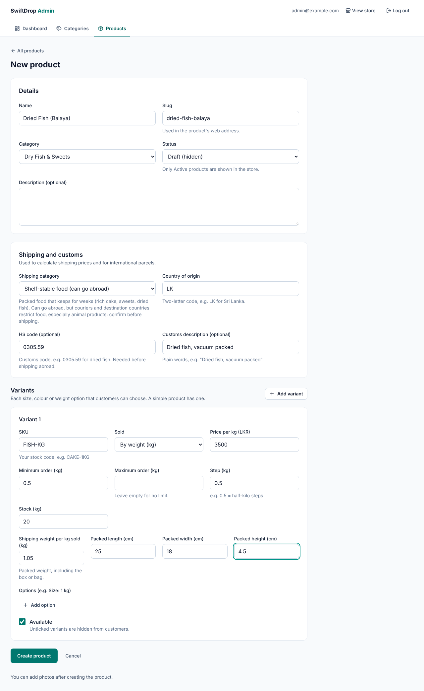
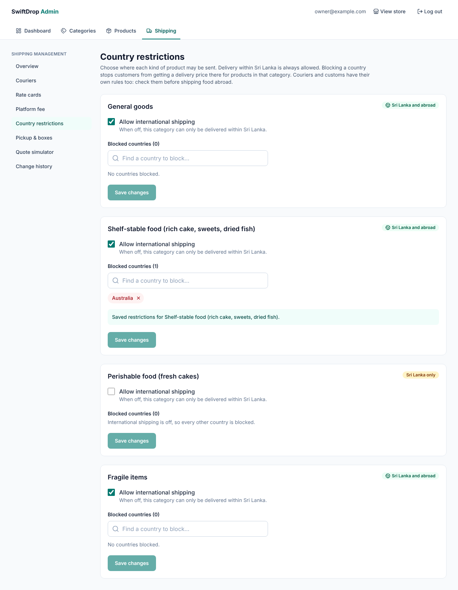
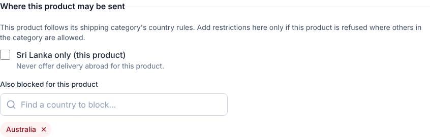
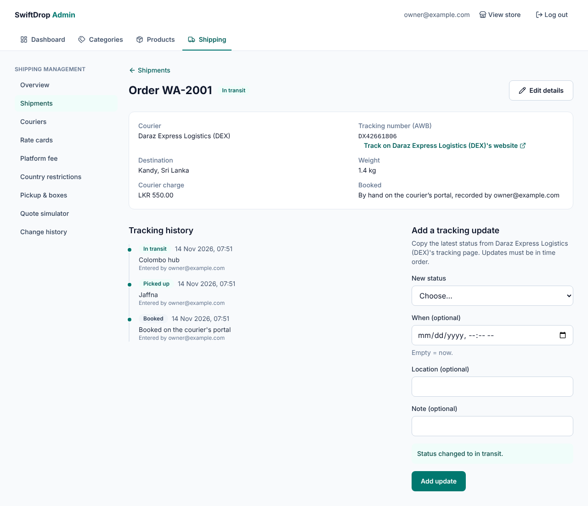
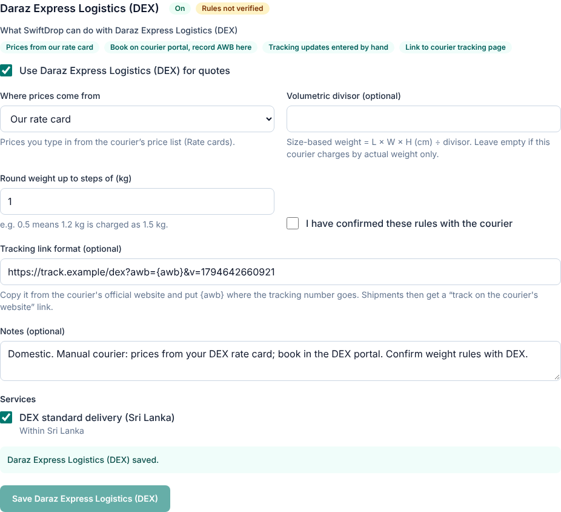
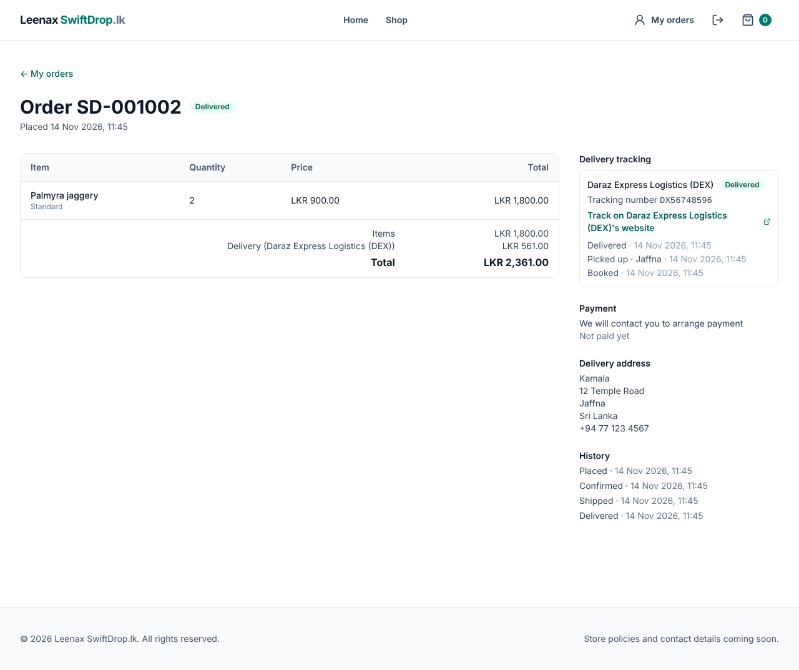
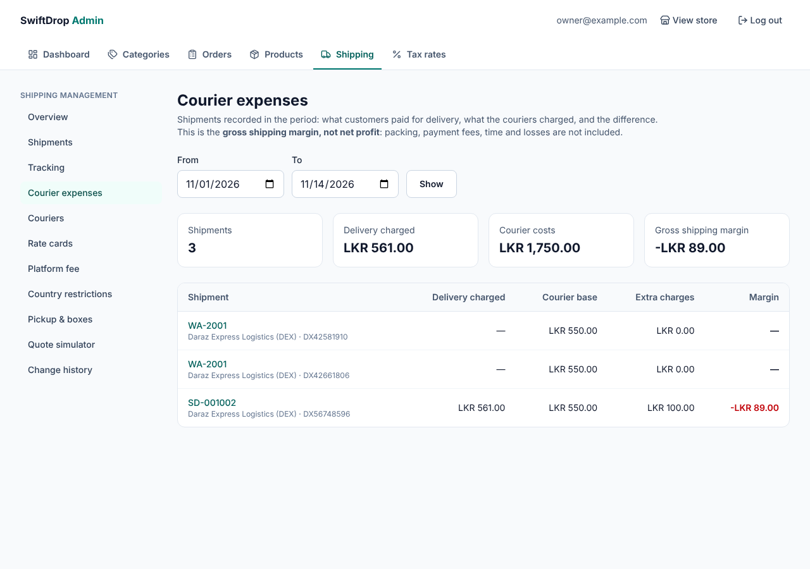
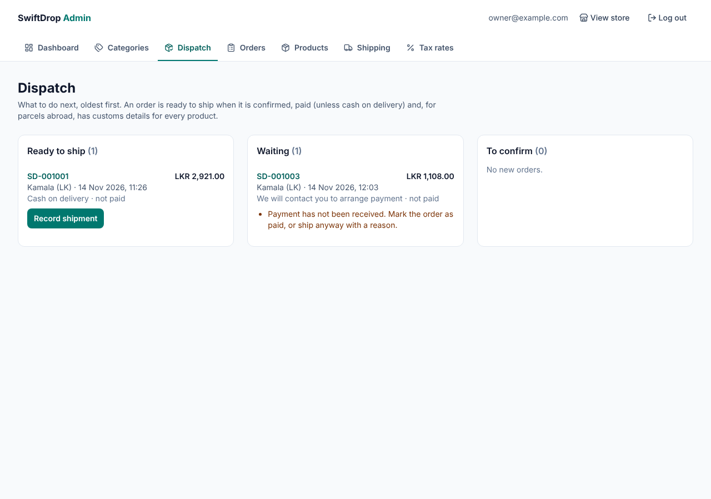

# Shipping and Courier Management: Audit and Design (Phase A)

Date: 2026-11-14 · Branch: `claude/create-projects-s4blmr` (commit `8e54108`)
Status: **approved 2026-11-14** (decisions in §13). Phase B implemented; see §14.

This document answers the six questions of the shipping request: what exists,
what's missing, which files change, which new files and tables are needed, how
shipping fits checkout and orders, and the phases with their tests. It ends
with **risks** and **decisions needed from the owner**.

---

## 1. What already exists (verified in the repository)

| Area | Status | Evidence |
|---|---|---|
| Architecture | Modular monolith, one Spring Boot app, packages under `lk.swiftdrop` | `catalog/`, `identity/`, `media/`, `config/`, `common/`, `store/` |
| Products | `Product` (seller, category, status, currency, `@Version`) | `catalog/product/Product.java`, `V3` |
| Variants | `ProductVariant`: SKU, price `NUMERIC(19,4)`, **sale unit PIECE/KG** with min/max/step, **stock** `NUMERIC(12,3)`, options | `V3`, `V4`, `V6` |
| **Shipping attributes** | ❌ **None**: no weight, dimensions, shipping category, HS code | — |
| Admin product UI | List (search/filter), form with `useFieldArray` variants, photos | `pages/admin/AdminProduct*.tsx` |
| Admin dashboard and routes | `/admin`, `/admin/categories/**`, `/admin/products/**`; lazy-loaded; `AdminLayout` tab bar | `routes.tsx`, `components/layout/AdminLayout.tsx` |
| Security | Session cookie + CSRF (`csrf.spa()`); `/api/admin/**` = ADMIN; deny by default; roles ADMIN, CUSTOMER, DELIVERY | `config/SecurityConfig.java`, `identity/Role.java` |
| Store settings | ⚠️ Only **constants**: default seller id and currency `LKR` (no settings table, no origin address) | `store/StoreDefaults.java` |
| Money | `BigDecimal` + `NUMERIC`; `MoneyResponse` (decimal string + ISO currency); frontend BigInt decimal maths | `common/money/MoneyResponse.java`, `frontend/src/lib/decimal.ts`, `money.ts` |
| Errors / API style | RFC 9457 `ProblemDetail`; `ResponseEntity`; `PageResponse`; `SortWhitelist`; `/api/...` public, `/api/admin/...` admin | `common/error`, `common/web` |
| Migrations | Flyway **V1–V7** applied; next is **V8** | `db/migration` |
| External HTTP client | ❌ None yet (only the AWS SDK for S3) | — |
| Scheduling | ❌ No `@EnableScheduling` | — |
| Audit log | ❌ Planned in the architecture, not built | `docs/ARCHITECTURE.md` |
| Charts (frontend) | ❌ No chart library | `frontend/package.json` |
| **Cart, checkout, orders, addresses, payments, delivery** | ❌ **Not implemented.** `/cart` is a placeholder page; these are master-plan **Phases 8–10** | `pages/CartPage.tsx`, `docs/BACKLOG.md` |
| Customer accounts | ⚠️ `users` + CUSTOMER role exist, but no registration or customer pages | `V5`, `identity/` |

**Conclusion:** shipping cannot be wired into checkout or orders yet, because they
don't exist. The parts of shipping that depend only on the catalogue (weights,
pricing, markup, rate cards, quotes, providers) can be built now. Shipment
booking and dispatch must wait for orders (and, for paid orders, payments).

## 2. Missing shipping features

1. Shipping attributes on products/variants (weight, dimensions, category, customs data).
2. Store origin address and shipping settings (packaging, default markup 2 %).
3. Courier providers and services with **per-provider** volumetric divisor and rounding.
4. Weight engine: actual, packaging, volumetric and chargeable weight.
5. Rate sources: courier API quotes (DHL) **and** admin-managed rate cards (manual fallback, e.g. DEX).
6. Markup rules (percentage/fixed/combined, scope, dates, min/max, enable/disable) with **audit history**.
7. Server-side shipping quotes with expiry and **price snapshots**.
8. Shipments, AWB/labels, normalized tracking, webhooks/polling, idempotent booking + reconciliation.
9. Courier expenses (quote vs invoice vs adjustments) and financial reports.
10. Integration logs (redacted).
11. Nine admin pages, plus customer tracking on order details (after orders exist).

## 3. Existing files that will change

| File | Change | Phase |
|---|---|---|
| `catalog/product/ProductVariant.java`, `VariantRequest.java`, `AdminProductResponses.java` | Weight and dimensions per variant | B |
| `catalog/product/Product.java`, `ProductRequest.java` | Shipping category; customs data (HS code, country of origin) | B |
| `catalog/product/ProductService.java` | Map the new fields | B |
| `frontend/src/features/admin/productSchema.ts`, `adminProductApi.ts`, `pages/admin/AdminProductFormPage.tsx` | "Shipping" fields in the product form | B |
| `config/SecurityConfig.java` | Rules for `/api/shipping/**` (quotes: public; tracking: owner only) and the webhook path (no CSRF, signature-checked) | C, F |
| `common/error/GlobalExceptionHandler.java` | Possibly a 502/503 mapping for courier failures | D |
| `SwiftDropApplication.java` or a config class | `@EnableScheduling` (tracking polling) | F |
| `components/layout/AdminLayout.tsx`, `routes.tsx` | "Shipping" menu and nine lazy routes | H (incrementally) |
| `docs/REQUIREMENTS.md`, `ARCHITECTURE.md`, `BACKLOG.md`, `PROGRESS.md`, `.env.example` | Requirements, decisions, settings | every phase |

Existing Flyway migrations (V1–V7) are **not modified**; all changes go in new migrations.

## 4. New backend files and database tables

### Package layout (follows the existing `lk.swiftdrop.<module>` style)
```
lk.swiftdrop.shipping
├─ config/     ShippingSettings (entity + service), CourierProviderConfiguration, CourierService
├─ provider/   CourierProvider (interface), ProviderCapability, DhlExpressProvider,
│              ManualCourierProvider, CourierProviderRegistry, provider DTOs
├─ parcel/     WeightCalculator, ParcelBuilder, PackagePreset   (pure Java, unit-tested)
├─ pricing/    MarkupRule, MarkupRuleService, ShippingPriceCalculator, RateCard(+Band)
├─ quote/      ShippingQuote, ShippingQuoteOption, QuoteService, ShippingQuoteController
├─ shipment/   Shipment, ShipmentParcel, ShipmentService, BookingService (idempotent)
├─ tracking/   TrackingEvent, TrackingStatus, TrackingPoller, CourierWebhookController
├─ expense/    CourierExpense, ExpenseService
├─ audit/      ShippingAuditLog, IntegrationLog (redacting writer)
└─ admin/      Admin*Controller classes, ShippingReportService
```
HTTP client for courier APIs: **Spring `RestClient`** (part of Spring Framework,
already on the classpath, no new dependency), with explicit timeouts.

### Proposed migrations (numbers are indicative)

| Migration | Tables / columns |
|---|---|
| **V8** product shipping attributes | `product_variants`: `shipping_weight_kg NUMERIC(10,3)`, `length_cm`, `width_cm`, `height_cm NUMERIC(8,1)` (nullable); `products`: `shipping_category VARCHAR(30)`, `hs_code VARCHAR(12)`, `country_of_origin CHAR(2)` |
| **V9** settings and providers | `shipping_settings` (single row: origin address, default packaging kg, default markup %), `courier_providers` (code, name, enabled, mode SANDBOX/PRODUCTION, integration API/MANUAL, capability flags, `volumetric_divisor`, `weight_rounding_increment_kg`, last connection check; **secrets are never stored here**), `courier_services` (provider, code, name, DOMESTIC/INTERNATIONAL, enabled), `package_presets` (box sizes + empty weight) |
| **V10** pricing | `shipping_markup_rules` (type PERCENT/FIXED/COMBINED, percent, fixed amount, min/max fee, scope courier/country, effective from/to, enabled, priority), `courier_rate_cards` + `courier_rate_card_bands` (manual rates by service, zone/country, weight band) |
| **V11** quotes | `shipping_quotes` (destination snapshot, parcel snapshot, weights, currency, expires_at), `shipping_quote_options` (service, courier price, markup applied, customer price, rule id/version, source API/RATE_CARD) |
| **V12** shipments and tracking | `shipments` (order ref, provider, service, status, AWB, courier reference, label object key, booking idempotency key, attempt count, last error), `shipment_parcels`, `tracking_events` (normalized status, courier status code, occurred_at, location, `UNIQUE(shipment_id, dedup_key)`) |
| **V13** money and logs | `courier_expenses` (type QUOTE/INVOICE/ADDITIONAL/ADJUSTMENT/REFUND, amount, currency, invoice no.), `shipping_audit_log` (who, what, before/after JSON, when), `integration_logs` (provider, operation, status, duration, **redacted** request/response summary, correlation id) |
| *(with master Phase 8)* | `orders.shipping_quote_option_id`, order shipping snapshot columns, `shipments.order_id` FK |

## 5. Weight and price calculation (server only)

### Where weights come from
- **PIECE variant:** `shipping_weight_kg × quantity` (e.g. a 1 kg cake box that weighs 1.3 kg packed).
- **KG variant** (sold by weight): the ordered weight itself + the variant's container weight, if any.
- **Packaging:** the chosen package preset's empty weight (or the default packaging weight from settings).
- **Dimensions:** from the package preset that fits the items. Version 1 picks the smallest preset whose volume and longest side fit; if none fits, the quote is marked **"manual review"** instead of guessing.

### Formulas (per provider settings, not hard-coded)
```
actual weight      = Σ item weights + packaging weight
volumetric weight  = (L × W × H in cm) ÷ provider.volumetric_divisor
chargeable weight  = max(actual, volumetric), rounded UP to provider.weight_rounding_increment_kg
```
Worked example (divisor and increment are **configuration**; real values come from the courier contract):
box 30 × 20 × 15 cm = 9,000 cm³ → ÷ 5,000 = **1.8 kg** volumetric; items 1.2 kg + box 0.3 kg = **1.5 kg** actual;
chargeable = max(1.5, 1.8) = 1.8 → rounded up to the next 0.5 kg = **2.0 kg**.

### Markup (platform shipping fee)
```
platform fee  = courier quote × percent + fixed        (by rule type)
              → clamped to [min fee, max fee] if set
              → rounded HALF_UP to 2 decimals (LKR)
customer pays = courier quote + platform fee
```
Example from the request: quote LKR 10,000.00, rule 2 % → fee LKR 200.00 → customer **LKR 10,200.00**.
A 0 % promotion is simply a rule with 0 % and a date range.

**Which rule applies:** only enabled rules whose dates include *now*; the most specific
wins (courier + country > courier > country > default); ties go to the highest priority,
then the latest start date. The applied rule's id and values are copied into the quote option,
so **later rule changes never alter existing quotes or orders**.
Every rule and settings change writes `shipping_audit_log` (who, before, after, when).

> Wording: reports call this **"gross shipping margin"**, never net profit. It ignores
> packaging materials, staff time, payment fees and other costs.

## 6. Couriers

### Common interface
```java
public interface CourierProvider {
    String code();                                   // "DHL_EXPRESS", "DEX"
    Set<ProviderCapability> capabilities();          // RATES, BOOK, LABEL, TRACK, PICKUP, CANCEL, WEBHOOK
    List<RateOption> quote(RateRequest request);     // only if RATES
    BookingResult book(BookingRequest request);      // only if BOOK; idempotency key in the request
    Optional<BookingResult> findBooking(String ourReference); // reconciliation, only if supported
    List<TrackingUpdate> track(String awb);          // only if TRACK
    void cancel(String awb);                          // only if CANCEL
}
```
Capabilities are **data**, so the admin UI and services know at runtime what each
courier supports. Anything a provider lacks falls back to **manual admin actions**.

### DHL Express (international): plan, **to be verified**
- The official reference is the MyDHL API (developer.dhl.com). **This environment could not reach it** (blocked by the network policy), so the endpoints, authentication, sandbox URL, rounding rules, label formats, pickup and webhook support are **not yet verified** and will **not** be coded from memory.
- Before Phase D: (1) the owner's DHL Express account and MyDHL API **sandbox** credentials; (2) network access from the development environment to the DHL developer and API hosts; (3) a reading of the official spec, recorded in `docs/shipping/DHL_VERIFIED.md` with links.
- Capabilities enabled only after a sandbox call succeeds and a recorded response exists as test data.

### Daraz Express Logistics (DEX, domestic)
- **No public API documentation is assumed.** Availability depends on a merchant/partner agreement.
- Built first as a **manual provider:**
  - rates from an admin-managed **rate card** (weight bands, zones or districts) from the DEX contract
  - the admin books in DEX's own portal, then enters the **AWB** in SwiftDrop
  - the admin updates the tracking status by hand (or uploads the label)
- If DEX later grants API access, a `DexApiProvider` replaces the manual provider for the verified capabilities only.

## 7. Integration with checkout and orders (after master Phase 8 exists)

```
Cart (server) ──▶ address ──▶ POST /api/shipping/quotes {cartId, addressId}
                                 server: load variants + quantities → parcel → domestic/international
                                 → rate options (DHL API / rate cards) → markup → save quote (expires e.g. 30 min)
Customer picks an option ──▶ order created with a SNAPSHOT: courier price, fee, customer price,
                              weights, rule id, address (never a price sent by the browser)
Payment verified (card) or COD allowed (domestic only, admin-controlled)
        ──▶ order becomes DISPATCH_ELIGIBLE (admin can also hold/release)
        ──▶ booking (automatic or "Book now"), idempotent:
              shipment row BOOKING_REQUESTED (unique per order) → call courier
              success → BOOKED + AWB + label
              clear failure → BOOKING_FAILED (safe retry)
              timeout/unknown → BOOKING_UNKNOWN → reconcile (provider lookup if supported,
                                otherwise admin confirms) → never blind retry
        ──▶ tracking (webhook if verified, else scheduled polling) → normalized statuses
        ──▶ customer sees tracking on the order page; notification (email, Phase 9)
```
- International shipments are **never** booked just because an order exists: they need verified payment and dispatch eligibility.
- Quotes are re-validated at order time: an expired quote, or a cart that changed, requires a new quote.
- **Normalized statuses:** BOOKED, LABEL_CREATED, PICKED_UP, IN_TRANSIT, CUSTOMS_CLEARANCE, OUT_FOR_DELIVERY, DELIVERED, EXCEPTION, RETURNED, CANCELLED. Each provider maps its own codes; unknown codes are kept raw and flagged.
- **Tracking events** are deduplicated by `(shipment, courier event id or hash of code+time+location)`.
- **Webhooks:** a separate path without CSRF, accepted only with a valid signature (if the provider supports one), plus rate limiting and logging.

## 8. Admin pages (route plan)

All under the existing `AdminLayout` with a new **Shipping** tab; lazy-loaded like the other admin pages.

| Page | Route | Built in |
|---|---|---|
| Shipping Overview (KPIs, date and courier filters, charts) | `/admin/shipping` | H (data from F) |
| Courier Providers (status, capabilities, enable, mode) | `/admin/shipping/providers` | C/D |
| Courier API Configuration (masked: "key configured ••••1234", test connection) | `/admin/shipping/providers/:code` | D |
| Shipping Rate Management (markup rules, rate cards, settings, history) | `/admin/shipping/rates` | C |
| Shipment Management (search order/AWB, filters, detail, label, retry/cancel) | `/admin/shipping/shipments` | F |
| Tracking Management (events, manual status update, unknown codes) | `/admin/shipping/tracking` | F |
| Courier Expenses (invoices, adjustments) | `/admin/shipping/expenses` | F |
| Revenue and Margin Reports | `/admin/shipping/reports` | H |
| Integration Logs (redacted) | `/admin/shipping/logs` | D |

**Charts:** the frontend has no chart library. Adding a small, well-known library such as Recharts is a dependency decision for the owner (alternative: simple hand-made SVG charts).

## 9. Security

- `/api/admin/shipping/**` is covered by the existing ADMIN rule; new public paths are added explicitly (deny by default stays).
- **Courier secrets live only in environment variables or a secrets manager.** The database stores *which* variable names are configured, never values. The API returns only "configured / not configured" and a masked suffix. Secrets **cannot** be edited from the browser.
- Configuration and rule changes are recorded in `shipping_audit_log`.
- Integration logs store **redacted** summaries: no addresses, phone numbers, names or credentials.
- Booking requires an eligible order (verified payment, or allowed COD) and is checked on the server.
- Customers can only see tracking for **their own** orders (IDOR checks as in Phases 6–7).
- Webhooks: signature verification where supported, replay protection, deduplication, rate limiting.

## 10. Implementation phases and tests

| Phase | Deliverable | Depends on | Key tests |
|---|---|---|---|
| **A** | This audit and design | — | — |
| **B** | Variant weight/dimensions, product shipping category, HS code, country of origin (V8); admin form fields | — | Validation, migration, product form tests |
| **C** | Settings, providers (data), package presets, **weight engine**, **markup rules + audit**, rate cards, **quote API** using rate cards; admin "Rates" and "Providers" pages | B | **Unit tests:** volumetric/chargeable weight per divisor and increment, rounding, markup types, min/max, 0 %, rule precedence, dates; integration: quote never trusts client prices; audit rows written |
| **E** | DEX **manual** provider: rate card, manual AWB, manual tracking | C | Manual booking/tracking flow; capability-driven UI |
| *(master Phase 8)* | **Cart, addresses, checkout, orders, COD**, using the quote API and order snapshots | C | Snapshot immutability; expired-quote rejection |
| **F** | Shipments, idempotent booking, reconciliation, tracking events, polling, expenses; Shipments, Tracking and Expenses pages | Phase 8 | **Duplicate-booking and retry tests**, timeout → UNKNOWN → reconcile, event dedup, IDOR on tracking |
| **G** | Dispatch eligibility rules (payment verified / COD), automatic booking trigger, customer tracking page | F, Phase 9 (payments) for card orders | Eligibility matrix tests |
| **D** | DHL Express integration (verified capabilities only), integration logs, API configuration page | owner's DHL credentials + network access | Provider tests with **recorded sandbox responses** (MockRestServiceServer/WireMock); no live calls in CI |
| **H** | Overview and reports pages with charts | F | Report sums vs fixtures; admin page tests |
| **I** | Security review, documentation, full regression | all | Authorization tests for every endpoint; all existing tests stay green |

**Recommended order:** A → B → C → E → *(master Phase 8: cart/checkout/orders)* → F → G → D (as soon as DHL access is ready) → H → I.
Each phase follows the usual workflow (plan, implement, test, report, commit, wait for approval).

## 11. Risks

| Risk | Impact | Mitigation |
|---|---|---|
| DEX API not available to this account | No automatic domestic booking | Manual provider and rate cards (planned as the default) |
| DHL account eligibility, contract rates, billing currency | Quotes may not be in LKR | Store the quote currency; refuse non-LKR quotes until an exchange-rate policy is decided (never invent rates) |
| **Perishable goods** (cakes) internationally | Couriers restrict food; customs rules | Product `shipping_category` (e.g. PERISHABLE → domestic only) |
| International customs (HS codes, declared values, duties) | Delayed or returned parcels | Customs fields in Phase B; decide who pays duties (sender or receiver) |
| Unknown booking outcome after a timeout | Double shipments and charges | BOOKING_UNKNOWN state + reconciliation, no blind retries |
| Volumetric rules differ by courier and contract | Wrong prices | Divisor and rounding per provider, set by the admin from the contract |
| Scope size | Long delivery time | Phases, each shippable and tested on its own |

## 12. Decisions needed from the owner

1. **Order of work:** approve the recommended order (B, C, E now; F/G after cart/checkout/orders).
2. **Origin address** for shipments (your pickup address).
3. **DHL:** do you have a DHL Express account and MyDHL API (sandbox) credentials? What is your billing currency?
4. **DEX:** do you have a DEX merchant account? Any API documentation from your account manager? Please share your **domestic rate card** (weight bands, zones).
5. **Perishables:** may cakes and other food be shipped internationally? (Recommended: **no**, domestic only.)
6. **Markup base:** apply the 2 % to the courier's **total** quote, including fuel and other surcharges but excluding import duties? (Recommended: yes.)
7. **International duties:** does the receiver pay import duties and taxes (common), or do you?
8. **Currency:** if a courier quotes in USD, should we wait for an exchange-rate policy (recommended), or only offer LKR quotes?
9. **Chart library:** approve adding Recharts for the admin charts (or plain SVG).
10. **Network access:** allow this development environment to reach the DHL developer and API hosts (needed in Phase D).

## 13. Owner decisions (2026-11-14)

| # | Decision |
|---|---|
| 1 | ✅ Order of work approved: B → C → E → master Phase 8 → F → G → D → H → I |
| 2 | ✅ Pickup address: **Sillalai South, Pandatharippu, Jaffna 40000, Sri Lanka** (placeholder until confirmed; the admin can change it in Shipping → Pickup & boxes) |
| 3 | ❌ No DHL account or MyDHL credentials yet: Phase D blocked |
| 4 | ❌ No DEX account, API documents or rate card yet: manual provider; rate card to be entered later |
| 5 | **Rich cakes, sweets and dry fish should be sent abroad** → category `FOOD_SHELF_STABLE` (international allowed by default); fresh cakes `FOOD_PERISHABLE` (domestic only). **Food, especially dried fish (an animal product), is restricted by some destination countries and needs courier approval: the owner must confirm per country.** A per-country block list per category is in Phase C (Shipping → Country restrictions) |
| 6 | ✅ Markup on the courier's total quote (including surcharges, excluding import duties) |
| 7 | ✅ **The receiver pays** import duties and taxes abroad (setting `dutiesPaidBy = RECEIVER`, changeable by the admin) |
| 8 | ✅ Wait for an exchange-rate policy: LKR quotes only until then |
| 9 | ✅ Add Recharts (in Phase H) |
| 10 | Later (network access for DHL, Phase D) |

## 14. Phase B — product shipping attributes (done 2026-11-14)



**Built**
- `V8__add_product_shipping_attributes.sql`: variant `shipping_weight_kg`, `length_cm`, `width_cm`, `height_cm` (positive; all three sides or none); product `shipping_category` (`GENERAL`, `FOOD_SHELF_STABLE`, `FOOD_PERISHABLE`, `FRAGILE`), `hs_code` (format checked), `country_of_origin` (default `LK`), `customs_description`.
- Meaning of the weight: **packed weight of one sale unit** (one piece, or one kg sold), so shipped weight = weight × quantity for both piece and kg selling.
- Backend: `ShippingCategory` enum, `ParcelDimensions` embeddable, request validation (including "all three sides or none"), admin-only responses, `shippingReady` flag on the admin list. Older requests without these fields still work (safe defaults).
- Admin UI: a "Shipping and customs" section with category help text (including the food warning), per-variant weight and packed size, and a **"Weight missing"** badge in the product list.
- Public API unchanged: customs data and packing details stay internal.

**Verified**
- Backend `mvn verify`: **59 tests** (3 new: save/read, defaults + `shippingReady`, validation incl. HS code, country code, partial dimensions, unknown category).
- Frontend `npm test`: **88 tests** (4 new: form saves all fields, validation messages, list badge, schema rules).
- Lint, types, build clean. Browser end-to-end: dried fish product saved with HS `0305.59`, 1.05 kg per kg sold, 25 × 18 × 4.5 cm, reloaded unchanged; a product without weight shows "Weight missing"; 0 console errors.

**Owner action:** enter the packed weight (and size, if known) for each variant. Products without a weight can't be quoted for shipping once Phase C is live.

**Next: Phase C** needs the pickup address (decision 2) and uses package presets (box sizes) entered by the admin.

## 15. Phase C — settings, weight engine, platform fee, rate cards, quotes (done 2026-11-14)



**Built (backend)**
- `V9__create_shipping_configuration.sql`:
  - `shipping_settings`: one row holding the pickup address (Jaffna placeholder), the default packaging weight (0.25 kg) and who pays duties (`RECEIVER`).
  - `courier_providers` and `courier_services`:
    - DHL Express: off, rates from the API (not connected), divisor 5000 and 0.5 kg steps, **marked not verified**.
    - DEX: on, rates from a rate card, no volumetric divisor, 1 kg steps, **not verified**.
  - `package_presets`: three boxes named "(example)" for the owner to replace.
  - `shipping_category_policies` and `shipping_category_blocked_countries`: international on/off plus blocked countries per category.
  - `shipping_markup_rules`: a default **2 %** rule.
  - `courier_rate_cards` and `courier_rate_card_bands`: LKR only, and they **start empty**, so no prices are invented.
  - `shipping_quotes` and `shipping_quote_options`: snapshots of each quote, with the courier price, fee and customer price stored separately.
  - `shipping_audit_log`.
- Pure engines, unit tested:
  - `ParcelCalculator`: picks the smallest box that fits, using an 80 % packing efficiency, rotation and weight limits; if nothing fits it flags "manual quote".
  - `ChargeableWeight`: volumetric weight = L×W×H ÷ the courier's own divisor; chargeable weight = max(actual, volumetric) rounded **up** to the courier's step.
  - `MarkupCalculator` and `MarkupRuleSelector`: the most specific rule wins (courier + country, then courier, then country, then the default), ties go to priority and then the newest start; min/max limits apply; HALF_UP to 2 decimals.
- `QuoteService` loads variants **from the database** and accepts no prices from the browser. It then checks:
  - that each product is for sale and the quantity is allowed
  - the category's country rules
  - that every item has a weight
  - the parcel, the courier rate card and the fee

  It saves the quote for 30 minutes when at least one option is available.
- APIs:
  - Admin, under `/api/admin/shipping/**` (ADMIN only): `settings`, `countries`, `providers`, `presets`, `category-policies`, `markup-rules`, `rate-cards`, `quotes/simulate`, `audit`.
  - Public: `POST /api/shipping/quotes` and `GET /api/shipping/quotes/{id}` return the **customer price only**, never the courier cost or the fee, and the POST needs the CSRF token.
- Every configuration change writes a before/after row to `shipping_audit_log`, in the same transaction, with the admin's email as the actor.
- JSON decimals are now exact strings (`"1.4"`, `"0.25"`) for all `BigDecimal` values.

**Built (admin UI, Shipping menu)**
- Overview: a set-up checklist plus the pages coming in Phases D, F and H.
- **Couriers**: no API keys are ever shown or stored here.
- **Rate cards**: list and editor with weight bands.
- **Platform fee**: rules list and form; it is described as a fee, not profit.
- **Country restrictions**: per category, an international on/off switch and blocked countries chosen by search and shown as chips.
- **Pickup & boxes**: the address, duties, packaging and box sizes.
- **Quote simulator**: the full breakdown, also for draft products.
- **Change history**: before and after for every change.

**Verified**
- Backend `mvn verify`: **92 tests**. 33 are new:
  - unit tests for the parcel, weight, fee and rule-selection engines
  - 13 integration tests: settings and audit, the DEX quote (550 + 11 = 561), customer view without cost or fee, DHL not connected, perishable food abroad, blocking one country, unknown codes, draft products, quantity rules, fee validation and audit, rate-card validation and 409, 401/403, CSRF
- Frontend: **102 tests** (14 new). Lint, types and build are clean.
- Browser end-to-end against PostgreSQL:
  - block Australia for shelf-stable food
  - enter the DEX Sri Lanka rate card (test prices)
  - simulate a 1 kg rich cake: 1.2 kg + 0.2 kg Small box = 1.4 kg, chargeable 2 kg, LKR 550 + LKR 11 fee = **LKR 561**
  - Australia shows "cannot be shipped"; the United Kingdom shows DHL "turned off"
  - the public quote shows only LKR 561
  - the history lists both changes
  - phone width: no sideways scrolling

**Owner feedback: restrict single products, not only whole categories (2026-11-14)**



- `V10__add_product_shipping_restrictions.sql`:
  - `products.shipping_domestic_only`
  - `product_shipping_blocked_countries`
- In the product form, under **"Where this product may be sent"**:
  - "Sri Lanka only (this product)";
  - "Also blocked for this product", using the same country search and chips.
- The rule: a product **follows its category** and can only **add** restrictions. A country is refused when the category blocks it **or** the product blocks it. A product can never unblock what its category blocks (the safer choice).
- Example: dried fish blocked for Australia, while rich cake (same category) can still go there. This was verified in the browser and by integration tests.
- The **Country restrictions** page lists "Products with their own restrictions", with Edit links.
- Changes are recorded in Change history as "Product restrictions".
- Tests: backend **95**, frontend **105**.

**Not built yet / limits**
- DHL live rates (Phase D). Until then, customers abroad get "contact us".
- Courier rules are placeholders until the owner confirms them with each courier.
- The public quote endpoint has no rate limiting yet (Phase 11). Old unused quotes are not cleaned up yet (a job in Phase F).
- Prices are in LKR only (decision 8).

**Owner actions**
1. Enter the real DEX price list in Rate cards. The test prices used in the checks were **not** saved to your data.
2. Replace the "(example)" boxes with your real box sizes.
3. Confirm the volumetric divisor and rounding with DEX (and DHL later), then tick "confirmed".
4. Check the pickup address. Block countries that refuse food imports (especially dried fish) for shelf-stable food.

## 16. Phase E — DEX manual courier: manual booking and tracking (done 2026-11-14)



**Why it is shaped this way**
- Orders don't exist yet (master Phase 8), so a shipment carries the owner's **own order reference as text**, e.g. from WhatsApp or phone orders. Phase F will link shipments to real orders.
- **No customer name, phone or address** is stored. That stays in the courier's portal.
- Nothing is sent to DEX and no booking is ever claimed by SwiftDrop: the admin books on the courier's portal or at its office, then records the AWB here.
- No DEX tracking address is assumed. The admin may paste the link format from the courier's official website, with `{awb}` where the number goes.

**Built (backend)**
- **Courier capabilities as data:**
  - `ProviderCapability` values: `RATE_CARD`, `LIVE_RATES`, `MANUAL_BOOKING`, `MANUAL_TRACKING`, `TRACKING_LINK`.
  - The `CourierProvider` interface, with `DexManualProvider` and `DhlExpressProvider`, plus `CourierProviderRegistry`.
  - Both couriers are manual until an API is verified. In Phase D, DHL adds its verified capabilities in one place.
- `V11__create_shipments.sql`:
  - `courier_providers.tracking_url_template`: must be https and contain `{awb}`.
  - `shipments`: the AWB is unique per courier, stored in capitals, 4–40 letters, digits or hyphens. Also courier cost, `booking_method`, and `@Version` optimistic locking.
  - `shipment_tracking_events`: never edited.
- **`TrackingStatus` steps** (the same status may repeat, e.g. a new "in transit" location):
  - BOOKED / LABEL_CREATED → label, pick-up, exception or **cancelled**.
  - Once **picked up**, a parcel can only move on (in transit, customs, out for delivery, delivered, exception) or be **returned**. It can't be cancelled.
  - DELIVERED, RETURNED and CANCELLED are final.
  - Updates must be in **time order** and can't be in the future (5-minute allowance).
- Admin API `/api/admin/shipping/shipments`:
  - search (order reference or AWB, status, courier; paged, newest first)
  - get, record (POST), correct details (PUT)
  - `POST /{id}/tracking`
  - The courier must be turned on and capable of manual booking. A service must belong to that courier.
  - Duplicate AWB → 409. Two people saving at the same moment → 409 (nothing is overwritten).
- Shipment creation and corrections are recorded in Change history. Tracking events are their own history and record who entered them.

**Built (admin UI)**
- **Shipments**: a list with search, a status filter and paging.
- **Record shipment**: only couriers that are on and can be booked by hand.
- **Shipment page**:
  - details, with a "Track on the courier's website" link when a link format is set;
  - the tracking history timeline;
  - the "Add a tracking update" form, which offers only the statuses allowed next.
- **Couriers**: shows "What SwiftDrop can do" for each courier, and has the tracking link format field.



**Verified**
- Backend: **110 tests**. New ones:
  - 7 unit tests for the tracking rules;
  - 8 integration tests: the full DEX flow to delivered, duplicate AWB, a corrected AWB is audited, a turned-off courier is refused, input checks (AWB format, unknown country, future time, another courier's service), time order, capabilities and tracking link, 403/404.
- Frontend: **112 tests**. Lint, types and build are clean.
- Browser against PostgreSQL (V11 applied on an existing V10 database):
  - set the link format, record a shipment (lower-case AWB stored in capitals), mark it picked up, then in transit;
  - "Cancelled" is no longer offered after pick-up; delivered closes the form;
  - a duplicate AWB is refused with a clear message;
  - phone width has no sideways scrolling;
  - the only console error is the expected 409.

**Not built yet**
- Linking to website orders, customer tracking page, automatic booking and dispatch rules (Phases F/G).
- Labels and API booking/tracking (Phase D for DHL; DEX only if DEX grants API access).
- Courier invoices and margin reports (Phases F/H). The courier charge per shipment is stored now for them.

**Owner actions**
1. Optional: copy the tracking page link format from DEX's official website into Couriers → DEX.
2. Record your next DEX parcel and update it as DEX's tracking page changes.

## 17. Phase F — shipments linked to orders, tracking, courier expenses (done 2026-11-14)



**Built**
- `V13__link_shipments_orders_expenses.sql`: `shipments.order_id` (NULL for orders taken outside the website), `courier_expenses`, and an index for the quote clean-up.
- **Shipment for a website order:**
  - On the admin order page, "Record shipment" opens the form already filled in: order number (read-only), the courier the customer chose, country, city and chargeable weight.
  - Only **CONFIRMED** (or already SHIPPED, for a second parcel) orders can be shipped. Nothing is booked just because an order was placed.
  - The destination must be the order's country.
- **Order status follows the parcel:**
  - picked up, in transit, customs or out for delivery → the order becomes **SHIPPED**;
  - delivered → **DELIVERED**;
  - returns are left to the owner.
- **Customer tracking:** "My order" shows each parcel: courier, AWB, the "track on the courier's website" link and the steps with locations. It never shows courier costs, internal notes or staff names.
- **Tracking page:** parcels still on their way, least recently updated first, with "No update for N days" from 2 days.
- **Courier expenses:**
  - The base charge is on the shipment. Extra charges are surcharge, return fee or adjustment (only an adjustment may be negative).
  - Charges are never edited (correct with an adjustment) and are audited.
  - **Report per period** (Sri Lankan dates, at most one year): delivery charged to customers vs courier costs = **gross shipping margin, not net profit**.
  - An order's delivery charge is counted once, on its first parcel.
  - Parcels without a courier charge are reported as missing, not as 0.
- **Nightly clean-up** (03:15 Sri Lanka): deletes quotes that expired more than 7 days ago and that no order uses.
- **Booking idempotency:** booking is still manual, and an AWB can only be recorded once per courier. API booking with idempotency keys and reconciliation comes with the first courier API (Phase D).



**Verified**
- Backend: **128 tests**, including 4 integration tests:
  - order → confirm → shipment → SHIPPED → DELIVERED, with the customer view free of notes, staff and costs;
  - expenses: sign rule, future date, totals, report margin, delivery counted once, missing cost, period check, 403;
  - the active tracking list;
  - quote clean-up keeps quotes that orders use.
- Frontend: **133 tests** (6 new). Lint, types and build are clean.
- Browser against PostgreSQL (V13 on an existing V12 database):
  - order SD-001002 confirmed, then shipped from the order page with prefilled details;
  - pick-up made the order SHIPPED; LKR 100 surcharge added (total LKR 650); delivery made it DELIVERED;
  - the customer saw the tracking with no staff email;
  - the report showed 561 − 650 = −89;
  - no console errors.

**Next:** Phase G (dispatch rules: payment checks before shipping, customer notifications), then D (DHL, when access is ready) and H (reports with charts).

## 18. Phase G — dispatch rules and dispatch queue (done 2026-11-14)



**Rules** (`DispatchCheck`, plain Java, unit tested): an order may be handed to a courier only when:
1. it is **CONFIRMED** (or already SHIPPED, for a second parcel);
2. **payment**: "we will contact you" orders must be **marked paid**. COD is paid on delivery, so it ships unpaid. The owner may ship an unpaid order anyway with a **written reason** (at least 5 characters). The reason is kept as an **internal note** in the order history, which customers never see. The override is only possible when the payment is the only problem;
3. **international**: every product has an **HS code and customs description**;
4. **warning only**: a product's country rules changed after the order was placed.

The rules are checked when a shipment is recorded for an order, shown on the admin order page ("Ready to ship?"), and drive the new **Dispatch** page: *Ready to ship* (with "Record shipment"), *Waiting* (with the reasons) and *To confirm*, oldest first.

**Not built, and why**
- **Automatic booking:** this needs a courier API. DEX has none, and DHL is Phase D. The Dispatch page is the manual equivalent. API booking will use the same rules.
- **Card-payment rules:** these depend on online payments (master Phase 9, decision D-6).
- **Customer emails** (order placed, shipped with tracking link, delivered): this needs an email provider and credentials. It is a new **owner decision D-13**. Until then customers follow their order on "My order".

**Verified**
- Backend: **135 tests**. New ones:
  - 5 unit tests: COD, payment override, placed orders, customs abroad, warnings;
  - 2 integration tests: an unpaid order waits, the reason is too short or OK, the note is hidden from the customer, the queue moves; a paid order is ready; 403 for customers.
- Frontend: **136 tests**. Lint, types and build are clean.
- Browser:
  - an unpaid confirmed order showed under *Waiting* with the reason;
  - it was shipped with a reason, which was recorded as an internal note and not visible to the customer;
  - no console errors.

